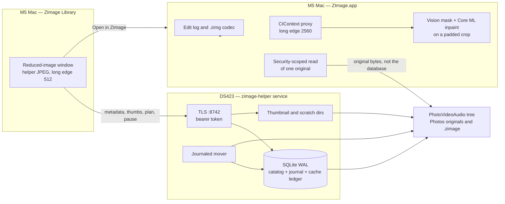
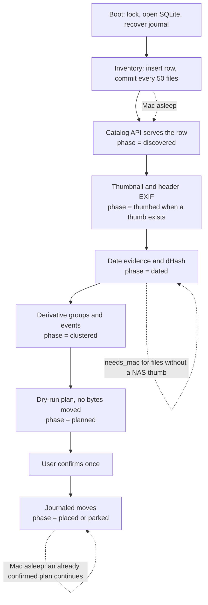
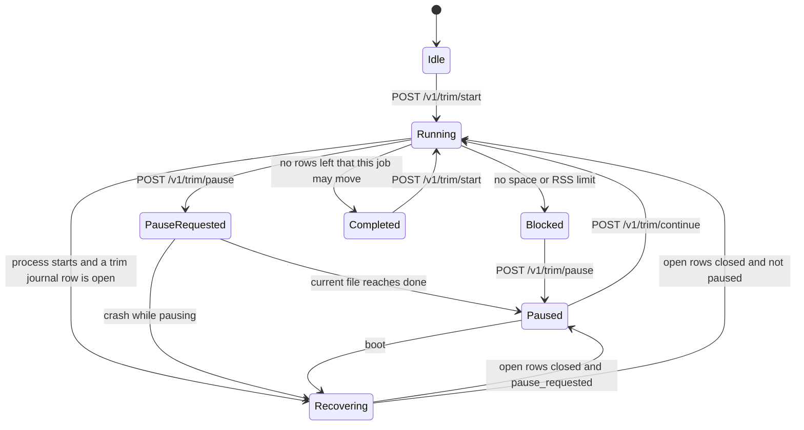
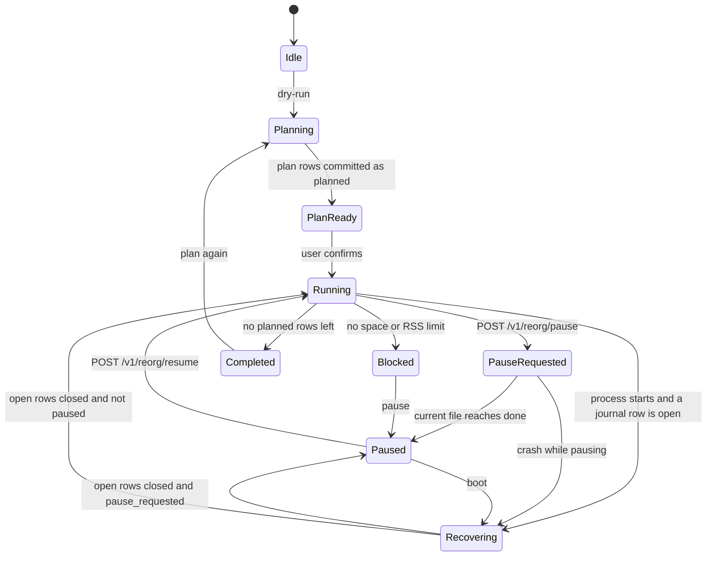

# ZImage Design

| | |
| --- | --- |
| Product | ZImage |
| Author | Thomas Zimmer |
| Date | 2026-11-07 |
| Status | In progress |
| Platform | Native macOS app, Apple Silicon, deployment target macOS 27.0. The build machine is an M5. The catalog and the reorganization state live on a Synology DS423. |
| Repository | `ZImage/` editor, `ZImageLibrary/` catalog window, `Helper/` Go source. `README.md` says how to build. |

## Overview

ZImage is built in two passes. Pass 1 is a single-window macOS editor. It opens a still image from anywhere the Mac can read, including an internal disk, an external disk, or a mounted share such as `/Volumes/BackupData/PhotoVideoAudio`. It views the image, edits it, and stores the result. Store means Save and Save As of a `.zimg`, and the other exporters, written to whatever folder the save panel points at. A local folder browser opens any folder and shows its still images. That browser is not a catalog. Pass 1 does not include the helper, SQLite, or a network API. The edit slice is global tone, white and skin eyedroppers, object removal, 90° rotation, horizon straighten, perspective and a small set of lens-adapter profiles, smooth zoom, and versioned export.

Pass 2 is the catalog for the personal library on that Synology share. Its helper source and library app are in this tree. It covers on the order of one million media files, with headroom to two million. It reorganizes the `Photos` tree by date and event without filling the Mac disk and without losing a file if the server reboots. It also tracks every instance of a photo, including different sizes, and can optionally move lower-detail copies into a duplicates store. Reorganization itself still deletes nothing.

The edited-document format is a versioned container, extension `.zimg`, nicknamed ZImage RAW in the product language. It stores a parametric edit log, not a second copy of every original. The million originals stay in their camera formats. In Pass 2, SQLite is not opened over SMB. A small Go helper on the DS423 is the only database writer. The Mac talks to it with an authenticated LAN API. Interactive edits run on a display-sized GPU proxy. Full resolution is a tiled export path.

As of 2026-11-07 the editor, the library app, and the helper source are in this tree. `ZImage/App/ZImageApp.swift` is the editor entry, and `ContentView` hosts the editor chrome. The sandbox is off. The deployment target is macOS 27.0. `STATUS.md` records what has landed. The paragraphs below keep the original plan, including choices that the code has since filled in.

## Background and Motivation

The library root the user named is `/Volumes/BackupData/PhotoVideoAudio`. On 2026-11-04 that path was mounted. `df` reported the filesystem as `//win32forth@DS423._smb._tcp.local/BackupData`, 21 TiB, 8.4 TiB used, 13 TiB available. A read-only `ls` of the share root showed `Audio`, `Books`, `Debbie Stuff`, `Documents`, `iTunes Music`, `m4v`, `mov`, `Movies`, `Music`, `PD Video`, `Photos`, `Toms Stuff`, `TV Shows`, `Video`, `Work Documents`, and `Work Downloads`. Nothing was modified.

The photo tree is `.../PhotoVideoAudio/Photos` (81 top-level names). It is not a clean camera roll. The top level includes year folders from 1964 through 2026 with gaps (1964, 1974, 1977, 1980 Ansel Adams, 1996, 1998, then 1999–2026), dump folders `1969-12-31` (4,431 entries at that folder's top level, names like `12341650816-12341651027769304.JPG`) and `1969-12-31a`, `1970-1-5`, and named albums including `Family Photos`, `Facebook Photos`, `Facebook Category Photos`, `Debbie Old Family Photos`, `Photos Library 1973-2010` through `Photos Library 2015`, `Photos Library Dad`, `Scans`, `Madrid`, `Indian`, `Nick Sara Wedding`, and `Blogger 1600`. `Photos/1999` contains day folders such as `1999-01-01` (90 entries under 1999; the day folder holds files such as `FUJIFILM_DX-10_1999-01-01_3640869453824.jpg`). Loose JPEGs and PDFs sit directly under `Photos/`. `Photos/.explorer-trash` exists (directory mtime 2026-10-12) and belongs to Duplicates Explorer, not to ZImage.

Prior observation, 2026-10-12, from Duplicates Explorer: the indexer scanned 961,565 paths and upserted 912,632 media files in about 31 minutes. A read-only query of `/Users/thomaszimmer/Sites/duplicates-explorer/data/index.db` on 2026-11-04 returned 911,834 rows and 3,979,446,206,435 bytes (about 3.98 TB). The `meta` table still records `count = 912632` and `indexed_at = 2026-10-12T19:36:08Z`. Extension histogram from that query:

| Extension | Kind | Count |
| --- | --- | --- |
| `.jpeg` | image | 564,007 |
| `.jpg` | image | 282,948 |
| `.raf` | image | 29,482 |
| `.x3f` | image | 8,944 |
| `.heic` | image | 8,353 |
| `.arw` | image | 5,669 |
| `.tif` | image | 2,909 |
| `.dng` | image | 2,590 |
| `.tiff` | image | 2,021 |
| `.mov` | video | 1,913 |
| `.cr2` | image | 906 |
| `.png` | image | 625 |
| `.orf` | image | 404 |
| `.mp4` | video | 243 |
| `.rw2` | image | 220 |
| `.raw` | image | 206 |
| `.gif` | image | 176 |
| `.avi` | video | 151 |
| `.webp` | image | 39 |
| `.nef` | image | 12 |
| `.m4v` | video | 6 |
| `.mpg` | video | 6 |
| `.bmp` | image | 4 |

Design load is about one million media files, with headroom to two million. "Tens of thousands" undercounts this tree.

Duplicates Explorer (`/Users/thomaszimmer/Sites/duplicates-explorer`, README at that path, UI port 8766, config `photos_root` = the `Photos` directory) is a separate product. Its index and thumbnails stay on the Mac. Its duplicate fingerprint is size plus the first 1 MB plus the last 64 KB. ZImage does not open `data/index.db`, does not write `data/thumbs/`, and does not delete through `.explorer-trash`. Journaled moves will make that index stale. Rebuilding it later with `python3 scripts/index_photos.py` is the user's choice and is a non-goal here.

PhotoBubba (photobubba.com and `~/Sites/photobubba-archive`) is a WordPress post archive. It is not this library. Named occasions already show up as folders (`Nick Sara Wedding`, `Madrid`, `Indian`). That is why an event is a database row with a folder name, not only free text.

The DS423, from the product specification updated 6 Aug 2026, is a Realtek RTD1619B (4 cores, 1.7 GHz, 64-bit ARM), 2 GB DDR4, 2×1 GbE, MTU ceiling 1500, 4× SATA. It is not the Intel DS423+. Container Manager on this unit is not a place to run a database or a model. Two gigabytes is the hard working set. A NAS process has a 256 MB RSS budget because DSM needs the rest. No jumbo frames. No ML inference on the NAS. A browser that pulled 100 MP originals across this link to paint a grid would not be interactive.

The Mac is the M5 on macOS 27. On 2026-11-04 this machine reported macOS 27.3 (build 26C5035r). `CGImageDestinationCopyTypeIdentifiers()` and `CGImageSourceCopyTypeIdentifiers()` were called locally. Those results are the encoder facts below. X3F is absent from the source UTI list (`NO_X3F_UTI`).

## Goals and Non-Goals

### Pass 1 goals

These are what gets built first.

- A native SwiftUI macOS editor on Apple Silicon, macOS 27. The sandbox is off. The user asked for that on 2026-11-05 because each build asked for file access again.
- Open a still image from any folder the Mac can read. A local folder browser lists the still images in a chosen folder and opens one into the editor. This browser is not the NAS catalog.
- Open the formats this library actually contains, plus the common camera RAW set, TIFF/TIF, DNG, PDF, and the ImageIO still formats macOS 27 already reads.
- Global adjustments listed in the tone section. One slider gesture is one undo step.
- Eyedropper with white mode and skin mode. Skin mode has seven presets. The temporary UI labels, confirmed on 2026-11-04, are Caucasian, Asian, Southeast Asian, Middle Eastern, Hispanic, South Asian, and African. The targets are measured facial chromaticities in the eyedropper section. Required in Pass 1.
- Undo and redo that survive save and reload, at least six steps in each direction.
- Versioned `.zimg` document with a migrator chain. Old schemas stay readable. Save and Save As write wherever the save panel points.
- Export JPEG, HEIC, TIFF, TIF, PDF, DNG, `.zimg`, and ten further formats with a named encoder for each.
- Interactive feel on a 100 MP file: proxy edits, smooth zoom from 0.1× to 4×.
- A preview-size slider on every image grid, from 80 pt to 480 pt. In Pass 1 that grid is the local folder browser. The slider is not the editor zoom.
- Click to select an object and remove it, stored as an undoable parametric operation.
- Quarter-turns, arbitrary straighten, perspective homography, and a small super-wide / panoramic adapter table.
- Architecture that adds a later editing control as a new command, renderer, and inspector row, not as a new file format.

### Pass 2 goals

Designed here. Not started until the user asks, after Pass 1 is usable.

- Catalog of about one million files, browsable while reorganization runs, database physically on the server.
- Date-and-event reorganization of image files under `Photos`, journaled so a reboot recovers, with Pause / Resume / Safe-to-reboot. The reorg places every member of a duplicate group and deletes nothing.
- Reorg cache on the server, hard cap 1 TB, operating target 200 GB.
- Duplicate groups that stay queryable, including different sizes. A detail score, not pixel count, names the keeper.
- An optional Trim job, separate from the reorg, that journal-moves non-keepers into `Photos/_Duplicates/`.
- A duplicates browser with Restore, pin, per-file permanent delete, and Delete all duplicates (typed `DELETE`, store only).
- The same preview-size slider on the library grid, the review park, and the duplicates store.

### Non-Goals

- iPhone, iPad, and visionOS, even though the Xcode template is multiplatform.
- Cloud sync, accounts, analytics, and any upload of pixels or GPS off the LAN.
- A Lightroom catalog importer.
- Deleting files as part of date/event reorganization. Trim and permanent delete are separate, optional, and limited to the duplicates store once a file has been moved there. There is no control that deletes the active library.
- Building Pass 2 before Pass 1 can open, view, edit, and store an image.
- Video editing. `.mov`, `.mp4`, `.m4v`, `.avi`, `.mpg` may be inventoried and badged in Pass 2. They stay in place.
- Facial recognition and named people.
- OCR of clocks, calendars, or captions, and any general "a model knows when this was taken" feature.
- Running vision models, Core ML, or a database container on the DS423.
- Opening SQLite across SMB. Pass 1 does not open SQLite at all.
- Importing or updating the Duplicates Explorer database.
- WordPress, PhotoBubba, or Synology Photos as a dependency.
- Bundling the Lensfun database.
- Mass undo of a finished reorganization or of a finished trim. The journal keeps source paths for 30 days so a later reversal is possible. Neither pass ships a reversal button. Restore from the duplicates store is the supported way back for a trimmed file.
- A brush to edit inpaint masks. Pass 1 selection is a click. A brush would be a new command later.
- Network reverse-geocoding of GPS to city names.
- A thumbnail pyramid. One JPEG per asset, long edge at most 512 px, scaled in the view.

## Key Decisions

1. **Build the editor first. The catalog is a second pass.** Pass 1 is the Mac app only: open a still image from anywhere the Mac can read (internal disk, external disk, or a mounted share such as `/Volumes/BackupData/PhotoVideoAudio`), view it, edit it, and store the result. Store means Save and Save As of a `.zimg`, plus the exporters, written wherever the save panel points. It also means a local folder browser: open any folder, show the still images in it, click one to edit. That browser is not the NAS catalog. It does not use the helper, SQLite, or a network API. Pass 1 includes the full edit slice: tone, zoom 0.1×–4×, geometry, the eyedropper and the seven MST presets, object removal, `.zimg` with persistent undo, and every exporter including linear DNG. Pass 2 is the Synology catalog, dating, events, journaled reorganization, the cache ledger, and the duplicate/trim system. Pass 2 stays specified in full in this document. It is not what gets built first, and it does not start until the user asks for it after Pass 1 is usable. Rationale: a million-file mover is the wrong first program. The editor has to open, view, edit, and store a real photo before any journal exists. The user said to begin there.

2. **Ship a macOS app only.** `SUPPORTED_PLATFORMS` becomes `macosx` and `SDKROOT` becomes `macosx` in the first PR. iOS and visionOS deployment keys in the template are unused. Rationale: every interactive path is Metal, Core Image, `CIRAWFilter`, PDFKit, and a sandbox bookmark to an SMB mount. A multiplatform UI would pretend those exist on iPhone.

3. **Zoom range.** The request "-10x to +4x" means a continuous magnification from 0.1× (ten times zoomed out) through 1× to 4× (four times zoomed in). 1× means one image pixel per screen point, not per retina pixel and not "fit." The slider is logarithmic on `[0.1, 4]`. Click zooms in by √2 about the click. Option-click zooms out by √2. Trackpad pinch is continuous. Fit-to-window may set a magnification below 0.1 when the image long edge exceeds ten times the view long edge; for that document the slider minimum drops to the fit factor and not below 0.05. A 100 MP frame is about 0.1× at fit in a typical window, so the common case stays inside the stated range. Rationale: a literal "slider from −10 to +4" is not a magnification, and rebuilding a 100 MP texture on each tick is not smooth.

4. **Undo is a parametric command log.** A 100 MP frame in 16-bit RGBA is `1e8 × 4 × 2 = 800 MB`. Float RGBA is `1.6 GB`. Six float frames are about 9.6 GB before the original and the redo tail. The log stores commands and, when it must compact, one parametric keyframe (`EditState`), never a bitmap. Default cap is 100 commands. The oldest commands collapse into one keyframe only when the cap is exceeded, and the most recent six commands are never collapsed, so six undo steps stay distinct. Redo is the tail after the cursor and is written into `.zimg`. Save and reload restore the cursor. A slider drag commits one command on mouse-up. Rationale: absolute parametric state is enough to render the current image after old steps are forgotten, so overflow does not bake a 100 MP base.

5. **Proxy long edge is 2560.** Tone changes re-render that proxy only. Zoom and pan are a GPU transform of the current texture. A higher-resolution tile (long edge at most 4096, visible region only) is requested after a 150 ms pause when the view is upsampling the proxy by more than 1.25×. Full-frame 100 MP is not decoded for interaction. Export renders in tiles of at most 2048×2048. Rationale: a 2560-long-edge `RGBAh` proxy is about 35 MB. One full float frame does not fit the interaction budget, and the 1 GbE link cannot feed a grid of originals.

6. **`.zimg` is not the library storage format.** Originals stay JPEG, HEIC, RAF, ARW, DNG, and the rest. A `.zimg` holds the edit log, a 2048 px JPEG preview, masks, and a pointer to the original: `fileRef` (absolute path hint, blake3, and a security-scoped bookmark blob) in Pass 1, or `catalogRef` once Pass 2 has an asset id. Embedding the original bytes is an explicit portable export, not the default Save. Rationale: embedding a million originals would roughly double a 4 TB tree, and embedding every 100 MP edit on Save would fill the disk the user is trying to protect. The user asked for a versioned RAW of the *edited* image. Pass 1 Save still restores undo because the log is in the `.zimg`, and the pixels are re-read from the file the bookmark names.

7. **Reorganization scope is image files under `/Volumes/BackupData/PhotoVideoAudio/Photos` only.** The user confirmed this on 2026-11-04. That tree includes `Photos/_Duplicates/`. Audio, Books, Documents, Movies, Music, TV Shows, Video, and the other share-root siblings stay where they are. The planner refuses a move whose source or destination is outside `Photos`. Rationale: those siblings are not a photo date tree, and moving them would destroy a media-server layout.

8. **The database lives on the NAS volume. The Mac never opens it.** The helper is a single static ARM64 Go binary (`CGO_ENABLED=0`, `modernc.org/sqlite`), started by DSM Task Scheduler at boot, RSS budget 256 MB, `GOMEMLIMIT=160MiB`. Docker is not used. SQLite over SMB is not used. Rationale: SMB locking corrupts SQLite. Go cross-compiles from the M5 with one environment prefix and does not need a C toolchain on the NAS. Rust would have tighter memory and a harder first PR. Vision models do not fit in 2 GB beside DSM.

9. **The catalog is browsable after inventory insert, before dating and before any move.** Moves run only from a confirmed plan. An already-computed plan keeps executing while the Mac is asleep. Perceptual hashes for files the NAS could not decode are checkpointed by the Mac later. Rationale: a one-million-file dating pass is allowed to take days. Browsing must not wait for it. The user said duration does not matter. Correctness and a usable catalog do.

10. **Journaled copy, then verify, then catalog update, then detach the source.** Source bytes are not unlinked until a same-volume backup rename has been recorded. Pause is observed between file transactions, and the reorg and Trim do not share a pause flag. They also do not run at the same time: each start endpoint returns 409 while the other job is in the states named in the trim section. Each job has its own helper-computed safe-to-reboot bit, false while that job has a journal row outside `{planned, done, failed}` or is `running`, `pause_requested`, or `recovering`. The server is safe to reboot only when both bits are true and no manual, restore, or purge row is open. A crash mid-write is recoverable because the source still exists and the journal names the recovery action. It is not harmless by itself. Rationale: a rename without a journal cannot distinguish "moved" from "copied and old path still live" after a power loss, and the DS423 will be rebooted.

11. **Server cache, operating target 200 GB, hard cap 1,000,000,000,000 bytes.** A ledger in SQLite is updated before the bytes count as kept. Thumbnails for one million 512 px JPEGs are about 40 GB. v1 embeddings in the file cache are empty; the 64-bit dHash sits in SQLite (about 8 MB). Rationale: the cap is a backstop, not the expected size. The Mac does not accumulate a parallel thumbnail store.

12. **Skin presets are measured facial chromaticities with temporary display labels.** Seven presets, CIE L\*a\*b\* under D65. The user confirmed these temporary UI labels on 2026-11-04: Caucasian, Asian, Southeast Asian, Middle Eastern, Hispanic, South Asian, African. The targets are the Lab values in the eyedropper section. The file stores `presetID`, not the display string, so a later label change does not need a schema change. The eyedropper always samples the clicked pixels. The preset is the destination chromaticity, not a substitute for the sample and not a flat fill. There is no worldwide skin-tone census in this design. Regional population totals are a planning proxy only. "Asian" is the East Asian chromaticity (MST 3). South Asian stays a separate preset (MST 7). Rationale: the user asked to use these names until they choose replacements.

13. **Pass 2 dating evidence is ordered and boring.** Reliable EXIF, then filename and path patterns, then agreement inside a dHash cluster, then filesystem times. Epoch dumps (`1969-12-31`, `1970-01-01`, and any timestamp shared by more than 25 files in one directory) are unreliable. Below confidence 0.70 the file is not placed in a guessed year folder. It is moved, unattended, to `Photos/_Review/Undated/<hh>/<file>`. Year-but-no-day evidence uses `Photos/YYYY/_NoDay/<event-slug>/` rather than inventing 1 January. Rationale: this library's bad EXIF is a known dump pattern, and the existing year folders are real structure.

14. **DNG v1 is a linear 16-bit RGB file written by `LinearDNGWriter`, not by ImageIO and not by the Adobe DNG SDK.** ImageIO on this Mac reads `com.adobe.raw-image` and does not list it as a destination. The SDK 1.7 redistributable terms have been reported missing from the download. Wrapping mosaiced samples is not v1: `CIRAWFilter` does not hand back the Bayer grid, and most files in this library are JPEG. Rationale: the user required DNG. A small TIFF-based linear writer is a PR a solo developer can finish and test. Mosaic DNG is a different product.

15. **The extra ten export formats** are PNG, WebP, AVIF, JPEG XL, JPEG 2000, PSD, OpenEXR, BMP, GIF, and TGA. Encoders are named in the export section from the macOS 27.3 ImageIO destination list plus libwebp and libjxl. TIFF and TIF are one container and two extensions.

16. **Sigma X3F is preview-only.** 8,944 files, no ImageIO UTI on macOS 27.3. The editor extracts an embedded JPEG or shows a visible error. It does not crash and it does not bundle a proprietary Sigma SDK.

17. **Chrome and canvas are different colors.** Side panels and toolbar are warm cream so type is easy to read. The well around the photograph is neutral `#5C5C5C` so the cream is not a color cast. PhotoBubba's web CSS is not reused.

18. **Object removal stores a mask and a model id, not a second 100 MP bitmap.** Interactive Core ML long edge is 1024. Export long edge is 2048, tiled if needed. The model is a Core ML conversion of LaMa, Apache-2.0, confirmed again when the weights are vendored.

19. **The keeper is the file whose pixels match the detail, and Trim is not the reorg.** Header megapixels do not pick the keeper. The score is the variance of a Laplacian on a preview scaled to a common long edge of 512. The keeper is chosen only among `placement = active` rows. Inside a 5% score band the smaller native pixel count wins, so a large upscale of a soft photo, or a large file with the same score, loses. Trim then moves every unpinned active non-keeper into `Photos/_Duplicates/`, including that larger near-tie. Reorganization places every member of a group and deletes nothing. Permanent unlink applies only to files already in that store, after a confirmation, and the catalog path becomes a tombstone so it cannot be relinked onto a live file. Rationale: this library has many sizes of the same photo. Keeping the biggest file would keep upscales. Leaving the upscale in the event folder after naming the small file keeper would undo the rule. Deleting during the date move would destroy the wrong file with no restore path.

## Proposed Design

### System architecture



Pass 1 is the editor. It reads a file the user picked, edits it, and writes a `.zimg` or an export through the save panel. Pass 2, as specified on 2026-11-04, is a background service plus a lightweight foreground app.

The service is `zimage-helper` on the DS423. DSM Task Scheduler starts it at boot. It does the catalog work behind the scenes: inventory, thumbnails, dating, journaled moves, Trim, and the cache ledger. It keeps running while both Mac apps are quit. It is the only writer of `catalog.db`, of moves, and of sidecars under `.zimage`. The Mac never opens SQLite.

The lightweight app is ZImage Library. Its window shows reduced images only. A cell is the helper JPEG, long edge at most 512, scaled by the preview-size slider from 80 pt to 480 pt. The library app does not decode a full original and does not run tone, geometry, object removal, or export. Choosing a still for a larger view hands that file to ZImage (`com.Win32Forth.ZImage`). ZImage opens the original over SMB and builds the 2560 proxy. The editor keeps Pass 1 Open File, Open Folder, Save, Save As, and Export. It does not grow the million-file grid. Catalog screens live in the library app: the year and event lists, review, duplicates, the reorg panel, and the trim panel. Save edits stays on the editor, because that is where the edit log is.

Pass 2 grids never read those originals. They ask the helper for metadata and for a thumbnail whose long edge is 512, then scale that bitmap to the preview-size slider.

Repository layout:

- `ZImage/App/ZImageApp.swift` — editor `@main`, window, bookmark. The editor keeps a helper client for Save edits. It does not present the library grid.
- `ZImage/Editor/` — `EditState.swift`, `HistoryLog.swift`, `TonePipeline.swift`, `Geometry.swift`, `Eyedropper.swift`, `Inpaint.swift`, `ProxyRenderer.swift`, `ZoomController.swift`.
- `ZImage/Document/` — `ZImgRaw.swift`, `VersionMigrator.swift`.
- `ZImage/Export/` — one type per encoder, including `LinearDNGWriter.swift`.
- `ZImage/Library/HelperClient.swift` — shared client, offline session, and the Open in ZImage handoff. PR 14 compiles it into the editor target so the tests have a host. The editor window does not show it. The library target compiles the same sources.
- `ZImage/UI/` — editor chrome, folder browser, preview-size slider, canvas, inspector. `OfflineBanner.swift` is the library-app banner. It is not mounted on the editor window.
- `ZImageLibrary/` — lightweight app target, added with the grid in PR 15. Bundle id `com.Win32Forth.ZImageLibrary`.
- `Helper/` — separate Go module `zimage/helper`, not linked into either app.
- `ZImageTests/` — macOS test target.

### What the app is today

There is no document model. PR 1 deletes the playground hello-world from the shipping target and adds the shell, the cream/neutral chrome, the history list, and an in-memory command log that can be exercised with a synthetic "exposure" command before any image opens. The placeholder bundle id `devplaceholder.$(PROJECT_UNIQUE_VALUE:identifier).$(PRODUCT_NAME:identifier)` (`PROJECT_UNIQUE_VALUE = ISQLBHN1`) stays until the app is distributed. `ENABLE_USER_SELECTED_FILES` stays `readonly` through the open, folder, and edit PRs. The open panel works with that setting. It becomes `readwrite` in PR 10, the first PR that presents `NSSavePanel`.

Entitlements once files and the helper exist:

- No App Sandbox. Both apps read and write the files the logged-in user can read and write. Library mutations still go through the helper.
- The keychain access group shared by ZImage and ZImage Library, so the helper pin and token survive a rebuild.
- No network server socket on the Mac. Outgoing connections need no entitlement once the sandbox is off.

### Editor model

Coordinates are normalized to the post-geometry image, origin top-left, y down. AppKit's bottom-left view space is converted at the view boundary.

```swift
enum EditCommand: Codable, Equatable {
    case keyframe(EditState)
    case setTone(ToneState, label: String)
    case setGeometry(GeometryState, label: String)
    case addInpaint(InpaintOp)
    case removeInpaint(UUID)
}

struct EditState: Codable, Equatable {
    var tone: ToneState
    var geometry: GeometryState
    var inpaints: [InpaintOp]
}

struct HistoryLog: Codable, Equatable {
    var commands: [EditCommand]
    var cursor: Int
    static let depthCap = 100
    static let minimumDistinctUndo = 6
}
```

PR 1 declares `ToneState`, `SkinGrade`, `GeometryState`, `LensSetting`, `NormPoint`, `CornerPin`, and `InpaintOp` in `EditState.swift` so this enum compiles. They are identity values: every tone slider at the default in the adjustment table, `skinGrade` nil, `quarterTurns` 0, straighten and both keystones 0, `corners` nil, lens profile `none` with `k1` and `k2` at 0 and `cylindricalFOV` nil, and an `InpaintOp` whose mask data is empty. The field lists in the geometry and object-removal sections are these same structs. PR 3, PR 7, and PR 9 fill behavior into them. They do not introduce the types. The tone sliders land in PR 3.

`SkinGrade`, declared beside `ToneState`, holds `presetID`, sample Lab, target Lab, `deltaA`, and `deltaB`. PR 8 fills the dropper that writes it.

Replay applies `commands[0..<cursor]` onto an empty `EditState`. `setTone` and `setGeometry` replace that part of the state. `addInpaint` appends. `removeInpaint` drops one id. `keyframe` replaces the whole state. Undo decrements `cursor`. Redo increments it. A new command while `cursor` is not at the end deletes the tail, and the cursor then equals `commands.count`. Compaction runs only after that, on a commit that is appending. When that commit would make `commands.count` exceed 100, commands strictly older than the last six are replaced by one `keyframe` of the state they produced, and `cursor` is set to the new `commands.count`. A cursor is never left past the end. The current image does not change, because the keyframe state is complete. Six undo steps remain distinct command boundaries. One hundred twenty appends compact to one keyframe plus the last six commands, and `cursor` is 7.

The history list shows one row per command at or before the cursor, plus dimmed redo rows after it. Clicking a row sets `cursor`. ⌘Z and ⌘⇧Z do the same. The list is the visible undo stack, not only the keyboard.

Provisional slider values live outside the log until mouse-up or a 400 ms idle after keyboard nudges, then one command is pushed.

Render order, fixed, regardless of the order the user touched the controls:

1. Decode the base (catalog original, or the embedded original, or the preview if decode support is preview-only).
2. Lens model, then perspective homography, then quarter-turns, then straighten angle. Crop to the finite bounds of valid pixels. Sharpness is last in this stage.
3. Inpaint operations in array order, masks in post-geometry normalized coordinates.
4. Tone, including temperature, tint, and the skin grade.

Eyedropper samples are taken from a small readback of stage 3, not from stage 4. A second click does not compound a correction that was already applied. Changing geometry later does not silently re-run the dropper. The stored result is the tone fields.

### Adjustment set (v1)

One `ToneState` struct. Slider defaults are identity for the photograph: the filter is omitted or its inputs are the values that do not change pixels. Those values are not always 0. The min, max, and default below were read from `CIFilter.attributes` on this Mac on 2026-11-04 (macOS 27.3). Ranges in the first column are the slider limits.

| Field | Slider | Identity input | Map |
| --- | --- | --- | --- |
| `exposureEV` | −5...5, default 0 | `CIExposureAdjust.inputEV` default 0, slider −10...10 | `inputEV = exposureEV` |
| `brightness` | −1...1, default 0 | `CIColorControls.inputBrightness` default 0, slider −1...1 | `inputBrightness = brightness` |
| `contrast` | −1...1, default 0 | `inputContrast` default 1, slider 0.25...4 | `0` maps to `1`. Positive: `1 + 3 × contrast` (`1` → `4`). Negative: `1 + 0.75 × contrast` (`−1` → `0.25`) |
| `highlights` | −1...1, default 0 | `CIHighlightShadowAdjust.inputHighlightAmount` default 1, slider 0.3...1 | `0` maps to `1`. The filter cannot go above 1, so a positive slider stays at `1`. Negative: `1 + 0.7 × highlights` (`−1` → `0.3`). `inputRadius` stays `0` |
| `shadows` | −1...1, default 0 | `inputShadowAmount` default 0, slider −1...1 | `inputShadowAmount = shadows` |
| `whites` | −1...1, default 0 | `CIToneCurve` diagonal, point3 `(0.75, 0.75)` | See the one curve below |
| `blacks` | −1...1, default 0 | point1 `(0.25, 0.25)` | See the one curve below |
| `texture` | −1...1, default 0 | no filter. `CIUnsharpMask.inputIntensity` default 0.5 is a sharpen, so it is not used as identity | `0` omits the filter. Positive: `CIUnsharpMask` with `inputIntensity = texture` and `inputRadius = 1.5 × longEdge / 2560`. Negative: `CIGaussianBlur` radius `1.5 × longEdge / 2560 × abs(texture)`, then `mix(original, blurred, abs(texture))` |
| `clarity` | −1...1, default 0 | same, omit the filter | Same shapes with radius `30 × longEdge / 2560` instead of 1.5 |
| `dehaze` | 0...1, default 0 | kernel returns the input. `0` subtracts nothing | Veil is the per-pixel min of R, G, and B, blurred by `CIGaussianBlur` with radius `32 × longEdge / 2560`. Output is `input − dehaze × veil`, clamped at 0, in a `CIImageProcessorKernel` whose ROI is the output tile. This is not a match of Lightroom Dehaze. The blur and the subtract both run in tiles at export |
| `vibrance` | −1...1, default 0 | `CIVibrance.inputAmount` default 0 | `inputAmount = vibrance` |
| `saturation` | −1...1, default 0 | `inputSaturation` default 1, slider 0...2 | `inputSaturation = 1 + saturation`. `0` maps to `1`, `−1` maps to `0`, `+1` maps to `2` |
| `temperature` | 2000...50000 K, default 6500 | `CITemperatureAndTint` neutral equals target | `inputNeutral = (6500, 0)`. `inputTargetNeutral = (temperature, tint)` |
| `tint` | −150...150, default 0 | target tint 0 | The same pair of vectors. Default temperature and tint leave neutral equal to target |
| `skinGrade` | optional, default nil | no cube | a\* and b\* deltas from the skin dropper, applied with a 32³ color cube built at render time. The cube is not stored. `nil` omits the cube |

Whites and blacks share one `CIToneCurve`. Identity is the diagonal. Point 0 stays `(0, 0)`, point 2 stays `(0.5, 0.5)`, point 4 stays `(1, 1)`. Point 1 is `(0.25, clamp(0.25 + 0.25 × blacks, 0, 0.5))`. Point 3 is `(0.75, clamp(0.75 + 0.25 × whites, 0.5, 1))`. Both sliders at 0 leave every point on the diagonal. The clamps keep the curve monotonic.

Filter order inside stage 4: exposure, highlight/shadow, tone curve, color controls, vibrance, temperature and tint, texture, clarity, dehaze, skin cube. Working format of the proxy context is `CIFormat.RGBAh`. Working color space is extended linear Display P3. The display view matches to the screen.

### Performance targets

These are targets, not measurements.

| Target | Value |
| --- | --- |
| Proxy long edge | 2560 px |
| Tone-slider frame on that proxy | ≤ 16 ms p95, one `CIContext` render, coalesced to the display tick |
| Zoom and pan | 60 fps. The proxy texture is not rebuilt |
| Time to first pixels, 100 MP, embedded preview or ImageIO thumbnail, over 1 GbE | ≤ 2 s |
| Refined 2560 proxy, 100 MP JPEG | ≤ 5 s |
| Scaled `CIRAWFilter` proxy, 100 MP RAW that ImageIO supports | ≤ 8 s |
| Catalog metadata, 200 rows, LAN | ≤ 200 ms p95 |
| Grid thumbnails | first image ≤ 500 ms, a page of 200 ≤ 2 s |
| Helper RSS | ≤ 256 MB |
| Editor memory for one open 100 MP file | the mapped file plus one ~35 MB proxy plus at most one 4096-long-edge tile. No second full-frame buffer |
| Export peak | < 2 GB, tiles ≤ 2048 |

Opening uses `CGImageSourceCreateThumbnailAtIndex` with `kCGImageSourceThumbnailMaxPixelSize = 2560`, `kCGImageSourceCreateThumbnailFromImageAlways = true`, and `kCGImageSourceShouldCache = false`. RAW uses `CIRAWFilter.scaleFactor` so the decoded long edge is about 2560, not native. The full-resolution `CGImageSourceCreateImageAtIndex` path is not used for the proxy.

Zoom past the proxy's resolution schedules a tile after 150 ms. A generation token cancels the tile if the user is still pinching. The tile is discarded on zoom-out and on document close.

### Zoom

`ZoomController` holds `magnification: Double` clamped as in Key Decision 3.

- Slider: logarithmic, labeled with the numeric factor (`0.1×` … `4×`).
- Zoom tool: click multiplies by √2 and recenters on the click. Option-click divides by √2.
- The Hand button is hidden. Zoom is the tool selected when an image opens. A click zooms in. Option-click zooms out.
- Pinch: `MagnificationGesture` multiplied into the current factor.
- ⌘0 fit. ⌘1 sets 1×.
- Space is a temporary hand pan. The pointer becomes an open hand while Space is held, and a closed hand while that drag moves the image. While Select is on, that pan stays off so the crop handles receive the drag. Leaving Select, Horizon, the eyedropper, or a finished crop returns to Zoom.

The canvas is an `MTKView` (or a thin `NSViewRepresentable` around one). On zoom and pan only the transform uniform changes. A counter in debug builds records proxy renders and is the done-test: a pinch must not increment it.

### Geometry

`GeometryState`, `LensSetting`, `NormPoint`, and `CornerPin` are declared in PR 1 inside `EditState.swift`. PR 7 fills the homography, the horizon tool, and the lens kernel in place. It does not introduce the types.

```swift
struct NormPoint: Codable, Equatable {
    var x: Double   // 0...1, post-geometry, top-left origin
    var y: Double   // 0...1, y down
}

struct CornerPin: Codable, Equatable {
    var topLeft: NormPoint
    var topRight: NormPoint
    var bottomRight: NormPoint
    var bottomLeft: NormPoint
}

struct GeometryState: Codable, Equatable {
    var quarterTurns: Int          // 0...3, clockwise
    var straightenDegrees: Double  // -45...45
    var verticalKeystone: Double   // -1...1
    var horizontalKeystone: Double // -1...1
    var corners: CornerPin?        // four normalized points, optional
    var lens: LensSetting
    var sharpness: Double          // -1...1, default 0
}

struct LensSetting: Codable, Equatable {
    var profileID: String          // "none" if manual
    var k1: Double                 // -0.50...0.20
    var k2: Double                 // -0.20...0.20
    var cylindricalFOV: Double?    // degrees, nil if rectilinear
}
```

- ⌘R rotates 90° clockwise. ⌘⌥R rotates 90° counter-clockwise. Each push is its own command. Pixels that were not upright in camera come back this way. `CIAffineTransform` with a 90° multiple, then the rest of the stack.
- Straighten is `CIStraightenFilter` with `straightenDegrees`. A horizon tool takes two clicks, computes `-atan2(dy, dx)`, and writes that angle clamped to ±45°. If the line is steeper than 45°, the tool applies one quarter-turn toward upright and then the residual, still clamped.
- Sharpness is −1...1, default 0, and sits in the Geometry panel. It runs after the transforms, on that stage’s output, before the crop. Zero omits the filter. Positive is `CIUnsharpMask` with intensity equal to the slider and radius `1 × longEdge / 2560`. Negative mixes a blur of that radius. A geometry record saved before this field decodes as 0. Double-click returns the knob to the middle, which is 0.
- Keystone builds a homography that moves the top and bottom edges (vertical) or the left and right edges (horizontal) while the center stays fixed, rendered with `CIPerspectiveTransform`. Four-corner mode stores the pins and uses the same filter. Output is cropped to the destination quad's bounding rect intersected with valid samples so the canvas stays finite.
- Lens profiles are a compiled table, not Lensfun. Choosing a profile copies its coefficients into `LensSetting`. After that the sliders are manual and the profile id remains as a label until the user picks another profile.

| Profile id | UI name | Model |
| --- | --- | --- |
| `none` | None | identity |
| `superwide-mild` | Super-wide adapter, mild | Brown–Conrady k1 = −0.15, k2 = 0.05 |
| `superwide-strong` | Super-wide adapter, strong | Brown–Conrady k1 = −0.28, k2 = 0.12 |
| `pano-120` | Panoramic adapter, 120° | horizontal cylindrical FOV 120° |
| `pano-180` | Panoramic adapter, 180° | horizontal cylindrical FOV 180° |

The k1 and k2 numbers are starting points, not measured calibrations of a named adapter. v1 is manual control plus this table. Auto-recognition of an adapter is out of scope.

Brown–Conrady is applied as a `CIImageProcessorKernel` (or a small Metal kernel sampled through `CIImage`) with normalized radius from the center. Cylindrical mode remaps x by `sin`/`tan` of the horizontal FOV and leaves y rectilinear. That is the v1 panoramic-adapter compensation. It is a projection remap, not a claim that every adapter glass is modeled.

### Eyedropper and complexion presets

The inspector panel is titled Color and sits under Tone, above Geometry. Temperature and Tint sit at the top of it. The eyedropper icon sits at the right end of the White and Skin row, and the menu command remains Eyedropper. Horizon and the eyedropper icon toggle. A brown border means the tool is on. A thin black border means it is off. Clicking the active button returns to Hand. The tool has two modes, White and Skin. Skin mode shows a preset picker. The click always samples the image.

**White.** Read back a 11×11 region at stage 3. Mean linear RGB. If the chroma variance is high, still apply and add the word "varied sample" to the history label. Convert the mean to CIE XYZ D65 and set `CITemperatureAndTint` so that chromaticity maps to D65. Store Kelvin, tint, and the sample RGB on `ToneState`. This is a global grade. It does not paint a gray patch.

**Skin.** Read back a 21×21 region. Median linear RGB per channel, then CIE L\*a\*b\* D65. The selected preset supplies target a\* and b\*. `skinGrade` stores `presetID`, sample Lab, target Lab, and `deltaA` / `deltaB`. L\* of the photograph is not replaced by the preset's L\*. The render builds a color cube that shifts a\* and b\* by those deltas. The clicked region moves toward the preset chromaticity. The rest of the photo gets the same global shift. No flat color is composited over the picture.

The first targets were the Monk Skin Tone cards (skintone.google; CIELAB from He et al., Journal of Imaging Science and Technology 68(5), 2024, Table I). Those cards are pale. Their a* is near 0 and their b* is far below a photographed face, so the grade pulled every picture toward blue. On 2026-11-05 the targets changed to measured facial skin. Lightness is still not written onto the photograph. The swatch is the sRGB of the new Lab color. `mst` remains the old card index and is not the color.

There is no authoritative census of skin tones. The population column is a 2026 order-of-magnitude planning proxy so the seven points cover the largest populations. It is not a measured share of complexions, and it is not a claim that a region has one skin color.

| Preset id | Temporary UI label | L\* | a\* | b\* | sRGB |
| --- | --- | --- | --- | --- | --- |
| `light` | Caucasian | 61.2 | 11.0 | 14.7 | #b08c7a |
| `lightGolden` | Asian | 61.7 | 10.0 | 16.9 | #b18e78 |
| `mediumGolden` | Southeast Asian | 56.4 | 10.0 | 19.0 | #a48067 |
| `mediumOlive` | Middle Eastern | 58.8 | 10.6 | 16.9 | #aa8670 |
| `mediumWarm` | Hispanic | 58.0 | 12.0 | 17.5 | #aa836d |
| `mediumDeep` | South Asian | 52.7 | 10.4 | 17.9 | #9a7760 |
| `deep` | African | 39.6 | 10.2 | 14.4 | #755746 |

Caucasian, Asian (the mean of the Chinese and Japanese rows), Southeast Asian, Middle Eastern (the mean of the Iraqi and Arabian rows), South Asian, and African are the Table 2 means in Lu et al., Skin Research and Technology, 2026. Hispanic is not in that table. Its redness and yellowness sit with the other medium faces. The labels stay the ones confirmed on 2026-11-04. The history list uses the same strings. A person can still pick any swatch. The click still samples the photo. The file stores `presetID`, not the display string.

"Asian" is the East Asian chromaticity (MST 3). South Asian stays a separate preset (MST 7) because that was the point of splitting them. Hispanic, Southeast Asian, Middle Eastern, and South Asian are the four extra names. They fill out the user's request for the top three other populations plus the East-versus-South split. Every label is temporary until the user replaces it.

The user named the deep preset with an older word. The app label is African. That older word does not appear in this document, the UI, the history label, or the schema.

### Object removal

Tool name: Remove object. Gesture: one click.

Selection uses Vision's `GenerateForegroundInstanceMaskRequest` (`VNGenerateForegroundInstanceMaskRequest`), run on the proxy scaled so the request long edge is at most 2048. The observation is an `InstanceMaskObservation` (`VNInstanceMaskObservation`) whose mask labels foreground instances. Hit-test the label under the click. If several instances contain the point, choose the one with the smallest area. Cap instance generation at 16. If the SDK that macOS 27.3 headers expose only returns per-instance masks, generate those at the observation's native mask resolution and test the click pixel. Do not generate masks at 100 MP.

If no instance contains the click, fall back to `ColorSimilarityMask`: 8-connected flood fill in CIE Lab from the click, ΔE76 threshold 12, on the proxy, stopping at 25% of proxy pixels. The history label says "color selection" so the fallback is visible.

`InpaintOp` is declared in PR 1 inside `EditState.swift`. PR 9 fills mask generation and the model call in place. It does not introduce the struct.

```swift
struct InpaintOp: Codable, Equatable, Identifiable {
    var id: UUID
    var maskPNG: Data            // grayscale, long edge ≤ 1024, normalized to post-geometry image
    var modelID: String          // "lama-big-coreml-v1"
    var featherPx: Int           // 8 at the interactive scale
}
```

No inpainted bitmap is stored. Replay runs the model again. A session cache keyed by `(base blake3, mask blake3, modelID, longEdge)` may keep the proxy-sized result in memory. It is not written to the catalog cache and it is dropped when the document closes.

Inpainter: a Core ML conversion of LaMa (Large Mask Inpainting, the `advimman/lama` weights known as big-lama). Code and those weights are Apache-2.0 as published. The PR that vendors the file re-reads the license inside the download and stops if it is not Apache-2.0 or a clearly compatible equivalent. Conversion is `coremltools` on the Mac. Input is float RGB, spatial size a multiple of 8.

- Interactive pass: bounding box of the mask, padded by the max of 32 px and 50% of the box on each side, scaled to long edge ≤ 1024, composited back with an 8 px feather.
- Export pass: the same crop in full-resolution coordinates, model input long edge ≤ 2048. If the padded crop is larger, tile with 128 px overlap and blend. Never upload a 100 MP frame to the model.

If the model file is missing, the interactive renderer uses `StubInpainter` (a blurred surround under the mask) so the command plumbing is testable. Export of a document that contains an `addInpaint` command fails with a visible error when the model is missing. It does not silently write the stub.

A brush, a dilate/erode on the mask, and a different model are future commands. They are not required to ship the click-to-remove path.

### Dust and scratches

The Touchup panel sits between Geometry and History. Its title has the same disclosure as the other panels: a down chevron while open, an up chevron while collapsed to the title. Dust finds small specks that disappear under a small opening or closing and are not sitting on an edge. Scratches finds thin lines whose two sides match and whose center does not. Each button is one history step, Dust or Scratches. Spot and Scratch use a circle whose diameter is the Size slider, from 8 to 400 preview pixels, starting at 48. Double-click that knob restores 48. Spot searches inside the circle. Scratch is a drag: the circle leaves a translucent gray stroke while the mouse is down, and letting go blends that whole stroke into the photo on either side. A second click on Spot or Scratch returns to Zoom.

The repair copies the surrounding color and adds nearby texture. It is stored as a mask on `InpaintOp`, model id `touchup-dust-v1` or `touchup-scratch-v1`, not as a bitmap. `strength` mixes that repair back over the photo. 1 is the full repair. 0 leaves the photo alone. Older files omit `strength` and mean 1. The Dust and Scratches sliders edit the latest step of that kind. A double-click on the knob restores full strength. Export writes this repair without the LaMa file. Object removal still refuses to export when that file is missing.

Opening a saved photo shows the picture that was on screen, or the `.zimg` preview JPEG when that picture is not still in memory. Dust does not run again until the next edit, undo, or export. That picture is not the edit base. The log stays the source of truth, and the next edit renders from the original proxy.

### ZImage RAW (`.zimg`)

Magic is the eight bytes `5A 49 4D 47 52 41 57 01` (`ZIMGraw` plus envelope version 1). Then a little-endian `u32` byte length of a UTF-8 JSON header, then that header, then section bytes. The header is uncompressed so a migrator can see `schemaVersion` without decoding image data.

```json
{
  "envelope": 1,
  "schemaVersion": 1,
  "appVersion": "1.0.0",
  "base": {
    "kind": "catalogRef",
    "blake3": "hex",
    "byteSize": 0,
    "assetUID": "uuid",
    "relativePathHint": "Photos/1999/1999-01-01/event/file.jpg",
    "uti": "public.jpeg"
  },
  "history": { "section": "history", "cursor": 0, "depthCap": 100 },
  "preview": { "section": "preview", "longEdge": 2048, "uti": "public.jpeg" },
  "sections": [
    { "name": "history", "offset": 0, "length": 0, "codec": "none" },
    { "name": "preview", "offset": 0, "length": 0, "codec": "none" },
    { "name": "masks", "offset": 0, "length": 0, "codec": "none" }
  ]
}
```

`kind` is `fileRef`, `catalogRef`, or `embedded`.

- `fileRef` is the Pass 1 default. The header stores an absolute path hint, the blake3, the byte size, and a security-scoped bookmark blob. Reload resolves the bookmark, checks the hash, and re-reads the original. No helper is involved. If the file has moved and the bookmark fails, the open panel asks the user to locate it. The hash must match or the edit log is not applied to the wrong pixels.
- `catalogRef` is the Pass 2 library sidecar. It stores the asset uid plus the hash. On open, a hint path whose hash is wrong is resolved through `GET /v1/assets?blake3=`. If the helper is down and the bytes are not at the hint, the document opens on the preview only and editing that would require the original is disabled, with the reason on screen.
- `embedded` copies the original into a `base-original` section. It is an explicit portable export, not Save. Use it when the file must travel without the original beside it.

Pass 1 Save and Save As write `fileRef` to the save-panel URL. They do not create a database row.

Sections: `history` (the `HistoryLog` JSON, cursor included, redo tail included), `preview` (sRGB JPEG, long edge 2048, shown on reopen when the on-screen picture is not still in memory, never the edit base), `masks` (the PNG blobs referenced by inpaint commands), optional `base-original`.

```swift
protocol VersionMigrator {
    static var fromSchema: Int { get }
    static var toSchema: Int { get }
    func migrate(_ document: ZImgRawDocument) throws -> ZImgRawDocument
}

enum VersionMigratorChain {
    static let currentSchema = 1
    static func migrateToCurrent(_ document: ZImgRawDocument) throws -> ZImgRawDocument
}
```

The reader applies migrators from the file's schema until `currentSchema`. The writer always writes `currentSchema`. A file whose schema is newer than the app throws `ZImgError.schemaTooNew` and is not modified. v1 has an empty migrator list past the identity. The chain is the extension point: schema 2 is a type that reads schema 1 and emits schema 2, registered in order, never skipped. `ZImageTests/Fixtures/schema-v1-minimal.zimg` is a committed fixture. The test loads it with a chain whose `currentSchema` is 1, and a second test injects a fake schema-1-to-2 migrator and checks that the fixture survives. A third test feeds schema 999 and expects `schemaTooNew`.

Reload restores `cursor`, so undo and redo both work after save. That is the acceptance test for the "six levels after reload" requirement: a fixture with eight committed tone commands, cursor at 8, reload, six undos, two redos, image state matches replay.

### Export

TIFF and TIF are one ImageIO container, UTI `public.tiff`. Open accepts both extensions. Export writes the bytes the user asked for and uses the extension they picked. The container does not change.

DNG is not in this table. It is the next section's writer. `.zimg` is the document export and is not one of the ten.

ImageIO destination UTIs measured on this Mac on 2026-11-04 (macOS 27.3, `CGImageDestinationCopyTypeIdentifiers`): `public.jpeg`, `public.png`, `com.compuserve.gif`, `public.tiff`, `public.jpeg-2000`, `public.heic`, `public.heics`, `public.avif`, `com.microsoft.bmp`, `com.adobe.photoshop-image`, `com.adobe.pdf`, `com.truevision.tga-image`, `com.ilm.openexr-image`, plus Apple/Khronos types that are not export targets (`public.heics` is the HEIC sequence UTI and is not used). Not destinations: `org.webmproject.webp` (source only), `public.jpeg-xl` (source only), `com.adobe.raw-image` (source only).

| Format | Encoder on macOS 27 | Notes in the export panel |
| --- | --- | --- |
| JPEG | ImageIO `public.jpeg` | 8-bit, quality slider 0.50–0.95, default 0.90 |
| HEIC | ImageIO `public.heic` | quality default 0.80. Panel says 8-bit until a round-trip test shows a 10-bit destination property actually sticking |
| TIFF / TIF | ImageIO `public.tiff` | 8- or 16-bit, default 16-bit LZW. Uncompressed is an option. Both extensions |
| PDF | PDFKit, one page | The rendered image is drawn into a single page at 1 point per pixel. Not ImageIO's `com.adobe.pdf` destination, so the page count is under our control. Multi-page export is out of scope |
| PNG | ImageIO `public.png` | 8- or 16-bit, default 16 |
| WebP | Bundled libwebp (BSD) | ImageIO does not write WebP on this Mac. Lossy quality 80 default, or a lossless toggle |
| AVIF | ImageIO `public.avif` | Lossy, quality default 0.70, 8-bit unless the round-trip shows otherwise |
| JPEG XL | Bundled libjxl (BSD-3-Clause) | ImageIO reads JPEG XL and does not write it. Lossy distance 1.0, or lossless, effort 7 |
| JPEG 2000 | ImageIO `public.jpeg-2000` | Quality via `kCGImageDestinationLossyCompressionQuality`. The test records whether 1.0 is lossless |
| PSD | ImageIO `com.adobe.photoshop-image` | Flat file, no layers. If the long edge exceeds 30,000, refuse and name TIFF or OpenEXR. If 16-bit fails the round-trip, offer 8-bit PSD and keep 16-bit TIFF |
| OpenEXR | ImageIO `com.ilm.openexr-image` | Prefer half-float. The test records the pixel format ImageIO actually wrote |
| BMP | ImageIO `com.microsoft.bmp` | Uncompressed, 8-bit per channel |
| GIF | ImageIO `com.compuserve.gif` | 256-color palette, dither. The panel says it is not a master |
| TGA | ImageIO `com.truevision.tga-image` | As ImageIO writes it. The test records bit depth |

libwebp and libjxl are vendored as source or as an XCFramework built on the M5. Versions are pinned in the export PR. No format is shown in the panel unless its encoder is linked and the round-trip test exists. JPEG XL in particular does not ship as a grayed-out promise.

Export renders the full pipeline in tiles of 2048 in the same working space as the proxy: extended linear Display P3, `CIFormat.RGBAh`. The gather step converts out of that space before the encoder sees the buffer. 8-bit JPEG, HEIC, PNG, GIF, BMP, WebP, AVIF, JPEG 2000, and TGA are encoded in sRGB with an embedded sRGB profile where the encoder has a profile slot. GIF is paletted after that conversion. 16-bit TIFF and 16-bit PNG are encoded in gamma-encoded Display P3, not linear, with a Display P3 profile embedded. OpenEXR stays linear Display P3, half float. PSD follows the bit depth just chosen: sRGB at 8-bit, Display P3 at 16-bit. PDFKit draws the sRGB image. Linear DNG is not converted to sRGB. It stays the linear Display P3 writer in the next section. A missing conversion fails the export round-trip: a 16×16 patch of linear Display P3 red `(0.5, 0, 0)` must come back from JPEG, through the embedded profile, as an sRGB red channel between 0.65 and 0.85. Storing the linear 0.5 as byte 128 fails that range.

The original file is not overwritten. The default export location is an `NSSavePanel` choice. A library sidecar `.zimg` is a different command, "Save edits", which `PUT`s the reference-style document to the helper. That command is Pass 2. It is PR 17. Pass 1 Save does not call it.

### DNG

Two different files are both called DNG:

- (a) A mosaic wrapper around original sensor samples.
- (b) A linear demosaiced RGB image of the rendered pixels, which the DNG specification allows as `PhotometricInterpretation` 34892 (`LinearRaw`) with three samples.

v1 writes (b) only. (a) is not available from `CIRAWFilter`, and 846,955 of the indexed files are `.jpg` or `.jpeg`.

`LinearDNGWriter` writes an uncompressed TIFF with the DNG 1.4 tags: `DNGVersion` 1.4.0.0, `DNGBackwardVersion` 1.1.0.0, `UniqueCameraModel` = `ZImage`, `CalibrationIlluminant1` = 21 (D65), `ColorMatrix1` for linear Display P3 to XYZ D65, `AsShotNeutral`, `SamplesPerPixel` 3, `BitsPerSample` 16, `Compression` 1, `PhotometricInterpretation` 34892. The Adobe patent license for implementations that read or write the DNG specification requires this notice in the writer source and in the app acknowledgements: "This product includes DNG technology under license by Adobe." The notice is included.

The Adobe DNG SDK is not linked in v1. The 1.7.1 download has been reported without a license file (Adobe community thread, August 2025, still unanswered as of October 2025). If `LinearDNGWriter` files fail a reader, the fallback is to re-evaluate that SDK only after a license file is actually in the archive we would vendor. Until then the intermediate that always exists is 16-bit TIFF plus the `.zimg` history.

Uncompressed 100 MP RGB 16-bit is 600 MB. The panel says so before writing. Lossless JPEG-inside-DNG is not v1.

The done-test parses the TIFF header and the `DNGVersion` tag, checks dimensions and photometric interpretation, and opens the file with ImageIO (this Mac already reads `com.adobe.raw-image`). Opening in Preview is part of the manual pass, not a unit-test assumption about Preview's DNG strictness.

### RAW and PDF, honestly

v1 tries ImageIO / `CIRAWFilter` for these extensions: `.raf`, `.arw`, `.dng`, `.cr2`, `.cr3`, `.nef`, `.nrw`, `.orf`, `.rw2`, `.pef`, `.srw`, `.erf`, `.raw`, `.rwl`, `.3fr`, `.fff`, `.iiq`, `.mos`, `.sr2`. The ones this library actually has in bulk are `.raf` (29,482), `.arw` (5,669), `.dng` (2,590), `.cr2` (906), `.orf` (404), `.rw2` (220), `.raw` (206), `.nef` (12). macOS 27.3 source UTIs include `com.fuji.raw-image`, `com.sony.arw-raw-image`, `com.adobe.raw-image`, `com.canon.cr2-raw-image`, `com.canon.cr3-raw-image`, `com.nikon.raw-image`, `com.olympus.raw-image`, `com.panasonic.rw2-raw-image`, and the other major camera UTIs. Support for a body is still whatever RAW compatibility macOS 27 shipped. A failure is a visible error naming the file and the UTI, not a crash. `CIRAWFilter.supportedCameraModels` can be logged when a RAW fails so the message can say whether the body is in the system list.

`.x3f` is the exception. ImageIO on this Mac has no Sigma / X3F / Foveon UTI. 8,944 indexed files. The open path is:

1. If the header is not `FOVb`, stop with "Not an X3F file."
2. Walk the X3F section directory within a 64 MB read budget and take the largest embedded payload that starts with a JPEG SOI and is at most 8 MB.
3. If ImageIO decodes that JPEG, open it with `decode_support = preview_only` and a persistent banner: "Sigma X3F preview only. Full Foveon decode is not available."
4. Otherwise `decode_support = unsupported` and a visible error. The catalog row remains. The mover may still place the file by date. The editor does not pretend the preview is the raw.

PDF import uses PDFKit. `PDFDocument` page picker shows page thumbnails. The default selection is page 1. Nothing flattens the document silently. The chosen page is rendered to a bitmap whose long edge is at most 8192. That cap is the edit base for the PDF, recorded on the document so export does not invent resolution. PDF export writes the rendered image as a one-page PDF. It does not re-wrap the original multi-page file.

### User interface

The editor is one window, minimum 1100×700. Pass 1 is a folder browser plus the editor. Pass 2 leaves that window as the editor. Catalog browsing is the ZImage Library window: a grid of reduced images, a short sidebar, the preview-size slider, the two reboot lamps, and Open in ZImage. The library window has no tone inspector and no canvas well. The editor canvas does not change between passes.

```text
┌ Toolbar ──────────────────────────────────────────────────────────────┐
│ Folder / Editor           Zoom  Remove                                │
│ Preview size 80–480 pt          (grids only)     Zoom 0.1×──4× (editor)│
├─────────────┬───────────────────────────────┬─────────────────────────┤
│ Sidebar     │ Canvas well #5C5C5C           │ Inspector               │
│ cream       │ the photograph                │ cream                   │
│ this folder │                               │ Tone sliders            │
│             │                               │ Color    Temperature Tint│
│             │                               │ Geometry         disclosure│
│             │                               │ preset swatches         │
│             │                               │ History list            │
│             │                               │                         │
│             ├───────────────────────────────┤                         │
│             │ filmstrip                     │                         │
└─────────────┴───────────────────────────────┴─────────────────────────┘
```

The library app holds the catalog sidebar (Years, Events, Review, Duplicates) and the status line with the helper, reorg, and trim lamps. That line is not drawn on the editor.

Regions, by name: thumbnail grid, editor canvas, adjustment inspector, geometry controls, eyedropper tool, history list, editor zoom slider, and in the library app the reorg panel and the duplicates panel. Tone and Geometry sliders sit on the same line as their names. The names share one right edge, then the slider, then the readout. The sliders draw at 56% of the system control height. Double-clicking a knob returns that slider to the middle of its track. Temperature, Dehaze, k1, and k2 do not. Geometry includes a Sharpness slider from −1 to 1. The gaps between those rows are 5.6 points. Rotate, the corner-pin switch, the lens menu, the panel titles, and the Horizon button keep their normal size and font. Temperature and Tint sit in the Color panel, above White and Skin. That panel's title is Color. The eyedropper icon sits at the right end of the White and Skin row. Horizon sits at the right end of the Rotate row. Horizon and the eyedropper icon toggle, with a brown border while on and a thin black border while off. Each of Tone, Color, Geometry, Touchup, and History has a disclosure at the right of its title. A down chevron means the panel is open. An up chevron means it is collapsed to the title. Open Tone, Color, and Geometry are as tall as their controls, with no scrollbar of their own. History is as tall as its steps. The panels share one scrollbar at the right of the inspector. A short window scrolls the whole column. A tall window leaves the panels at that content height. Undo, Redo, and Push tone sit in the toolbar above the Tone panel. Copy settings and Paste settings sit to the right of Push tone. Copy keeps the Tone and Geometry settings. Paste applies them in one history step and leaves crop and object removal unchanged. On the Image view, Select, Crop, and Export sit at the right edge of the image area, to the right of Folder and Image. Select outlines the whole image. Dragging a corner, or the middle of a side, changes that edge. Clicking Select again leaves Select. Crop stays disabled until the rectangle is at least 2 pixels on each side. Crop is one history step named Crop. Filmstrip uses the same preview-size slider as the grids. It is not a second thumbnail size.

**Pass 1 folder browser.** File → Open Folder uses `NSOpenPanel` with directories allowed. That folder is the root of a directory tree on the left. The next launch opens that same tree and selects the folder that was selected when the app quit. If that folder cannot be opened, the tree stays empty. The tree lists directories only, one level when a row opens. Sub-folder, written to the left of its checkbox and to the left of View, searches subfolders and shows the images and videos it finds in the Folder view. With Sub off, the Folder tab lists the still images ImageIO can identify and the video files in the selected folder, and does not list files inside subfolders. Sub's walk stays under the selected folder. The browser does not write SQLite. Double-clicking an image, or Edit Image on its right-click menu, opens it on the Image tab. Double-clicking a video opens it in QuickTime Player. That menu also has Show in Finder and Open In. Open In lists the applications that can open a still, with ZImage first. A video menu uses Open With, and that list is the video players, with QuickTime Player first. The last line is the file size in decimal megabytes. File → Open File opens one image from anywhere, including a mounted share, with the same editor. Previews for the grid are a single JPEG per file, long edge at most 250 px, JPEG quality 70%, written under `FileManager.temporaryDirectory/ZImage/folder-previews/` with an LRU cap of 200 MB. The files stay when the app quits and when another folder is opened. The three-bar menu to the left of Open File has Cache: Set Cache Size, View Cache, and Clear Cache. Export sits to the right of the Folder and Image selector and is shown only while Image is selected. The view scales that bitmap. There is no pyramid and no per-slider-position render.

**Preview-size slider.** Every grid uses one control, `PreviewSizeSlider`, in that grid's toolbar. Range 80 pt to 480 pt, default 160 pt, labeled "Preview size". It sets the cell's long edge. The editor folder bitmap stays ≤ 250 px. The library bitmap stays ≤ 512 px. This slider is not the editor zoom. Editor zoom stays on the canvas toolbar and is the 0.1×–4× control from the zoom section. Pass 2's library, review park, and duplicates store reuse the same slider and the same 512 px JPEG. They do not invent a second thumbnail size.

In the folder browser, the center has a Folder tab and an Image tab. Double-clicking a still shows that file on the Image tab and leaves the folder listing in place. Double-clicking a video opens QuickTime Player and leaves the folder listing in place. Switching between the Folder tab and the Image tab keeps the folder grid's scroll position. The Folder tab returns to those previews. In the library app, choosing a still runs Open in ZImage and leaves the reduced-image grid where it is. Captions are 12 pt, filename, and in Pass 2 the catalog date. Pass 2 grids page 200 cells.

**Pass 2 duplicates UI.** This screen is in the library app. The sidebar has a Duplicates item. The grid shows `Photos/_Duplicates`, grouped, with the same preview slider. Each cell shows `detail_score` to one decimal, `native_pixels` as megapixels to one decimal, and a Keeper badge on the keeper (the keeper itself stays in the event folder; the badge in the group header names it). Open in ZImage hands the file to the editor: proxy, zoom 0.1×–4×, no separate player.

Actions, word labels:

- Remove from library. Available on an active image. Journal-moves that file into the duplicates store and tags the row `manual`. It does not unlink bytes. No typed confirmation. The Delete key does not do this and does not permanently delete anything.
- Trim panel, separate from the reorg panel: Start, Pause, Continue, and that job's own safe-to-reboot lamp. Starting Trim does not start or pause the reorg.
- Restore. On a file in the store. Journal-moves it beside the keeper in the keeper's event folder and sets `pinned`. The catalog shows it as an intentionally kept sibling.
- Pin is visible on that sibling. Clearing the pin is an explicit control. Later trims skip pinned rows.
- Delete permanently. On one file in the store. Short confirmation: a dialog names the filename, buttons Cancel and Delete permanently. The request is refused if the path is not under `Photos/_Duplicates/`.
- Delete all duplicates. On the store only. The dialog requires the user to type `DELETE`. It unlinks every file currently in the store and no file outside it. There is no "delete the whole library" control.

The reorg panel keeps its own Start, Pause, and Resume. Pausing the reorg does not pause Trim, and the reverse is also true. Start on one returns 409 while the other is in the states in the trim section, so the two movers are not in `running` together. The library window shows two lamps plus the combined line. A server reboot is safe only when that combined line is green: both job lamps, and no open manual, restore, or purge row. Either job mid-file makes its own lamp amber, and the status line says which job is not safe. A purge in progress ambers the combined line even when both job lamps are green.

**Type and color.** SF Pro. Inspector labels 13 pt, section headers 15 pt semibold, nothing under 12 pt. Sidebar 13 pt.

| Role | sRGB |
| --- | --- |
| Panel background | `#F4EFE6` |
| Primary text | `#1C1915` |
| Secondary text | `#5C564C` (about 6:1 on the panel) |
| Hairline | `#E0D8CC` |
| Selection fill | `#E7D3C3` |
| Accent | `#8C5A3C` |
| Canvas well | `#5C5C5C` |

The well is the only neutral surround. Cream does not extend behind the image. PhotoBubba CSS is not a source. Tools have word labels, not icon-only buttons. The Delete key does nothing to files in either pass. Permanent delete is only the named buttons above.

Keyboard: ⌘Z undo, ⌘⇧Z redo, ⌘R rotate clockwise 90°, ⌘⌥R rotate counter-clockwise 90°, ⌘0 fit, ⌘1 actual pixels, E eyedropper, Z zoom tool, Space hand.

Each job's lamp is driven only by that job's `safeToReboot` bit from the helper. The combined line also watches `manualOpsClear`. The Mac does not invent either bit. Green text "Safe to reboot" when the bit it displays is true. Amber "Not safe to reboot" while a journal row for that lamp is open, including `purge_planned` and "Pausing after the current file."

### Helper, database, and phases

Go module in `Helper/`. Build: `GOOS=linux GOARCH=arm64 CGO_ENABLED=0 go build -o zimage-helper`. SQLite is `modernc.org/sqlite` so the binary is static. DSM Task Scheduler runs it at boot as a non-admin user that can read and write the `BackupData` shared folder. It must not run as root. The binary lives on the data volume, `PhotoVideoAudio/.zimage/bin/zimage-helper`, because a DSM update can clear `/usr/local`. The task is "run at boot." A lock file `.zimage/helper.lock` is held with `flock`. A second start exits if the lock is held. PID goes to `.zimage/helper.pid`.

The SMB path and the DSM path differ. On 2026-11-04 the share name is `BackupData` and the library directory inside it is `PhotoVideoAudio`. The DSM-local root is commonly `/volume1/BackupData/PhotoVideoAudio` when that shared folder is on volume 1. The helper does not guess. `config.yaml` sets `library_root_local`. Startup checks that `<root>/Photos` exists and is writable, then listens. If the check fails, the process serves `/v1/health` with the error and does not move files.

```yaml
listen: "0.0.0.0:8742"   # tcp4 only
library_root_local: "/volume1/BackupData/PhotoVideoAudio"
scope_relative: "Photos"
cache_operating_bytes: 200000000000
cache_hard_bytes: 1000000000000
```

`GOMEMLIMIT=160MiB`. Every 10 seconds the helper reads `/proc/self/statm`. Above 256 MB RSS it drops thumbnail and hash work and keeps the API. Above 320 MB it stops the mover after the current transaction and sets the job `blocked`. SQLite `cache_size` is −8000 (about 8 MB). One write connection, one read connection. WAL. `busy_timeout` 5000. `foreign_keys=ON`. Move transactions use `synchronous=FULL`. Inventory batches of 50 inserts may use `synchronous=NORMAL` because a lost batch is rediscovered by the walk. On btrfs, the catalog directory is created with copy-on-write disabled (`chattr +C` on the directory before `catalog.db` exists). SQLite WAL plus btrfs CoW has a history of fragmentation and bad power-loss behavior.

Layout under the share, all of it server-local:

```text
PhotoVideoAudio/.zimage/
  bin/zimage-helper
  config.yaml
  auth.token
  tls/cert.pem
  tls/key.pem
  helper.lock
  helper.pid
  catalog/catalog.db
  logs/helper.log
  edits/<assetUID>.zimg
  cache/thumbs/ab/<assetUID>.jpg
  cache/embeddings/          # empty in v1
  cache/scratch/             # uncommitted, deletable
  move-scratch/<journalID>
  move-backup/<journalID>
```

`PAIRING-TOKEN` exists only until the Mac claims it.

**Listening and token.** The helper listens with `net.Listen("tcp4", "0.0.0.0:8742")`. v1 does not open an IPv6 socket. TLS 1.2+ with a P-256 certificate generated on first start. The Mac pins the SPKI hash at pairing. Bearer token is 32 random bytes, base64url, compared with a constant-time equality. It is stored mode 0600 in `auth.token` and in the Mac keychain (`kSecClassGenericPassword`, service `ZImage NAS Helper`). The keychain account is the helper host string, stored beside the pin. Pairing: the helper writes `PhotoVideoAudio/.zimage/PAIRING-TOKEN` once. The Mac reads it over the existing SMB mount, resolves the SMB server name to an IPv4 A record, stores that host with the pin, calls `POST /v1/pair/claim` on `https://<that-ipv4>:8742`, and the helper deletes the file. On this Mac the mount host is `DS423._smb._tcp.local`. Later calls use the stored host and send `Authorization: Bearer`. A changed host with the same pin is a hard failure until the user pairs again, same as a changed pin. If the name has no A record, the client shows "Helper address is not IPv4" and does not dial. A guest who can only hit the port cannot read the share and cannot get the token. A guest who can already read the share can already see the photos. The helper rejects source addresses that are not RFC 1918 or IPv4 link-local (`169.254.0.0/16`). An IPv6 address never reaches the process. Failed authentication: 30 attempts per minute per IP, then a five-minute silence. Responses never echo paths on 401.

**Helper down.** This is the library app's window. If that window already has a page, it stays up with the banner "Helper offline. This grid is the last response and is not a saved catalog." Writes are disabled. If the library app launches with the helper down, its pane is an empty offline state, not a reconstructed library. There is no SQLite file on the Mac, including in Application Support. Quitting drops the in-memory page. The editor can still open a file chosen in the open panel, and Save As of a `fileRef` `.zimg` still works. Save edits to the library stays disabled until the helper answers. The offline banner also names the DSM recovery: open DSM Task Scheduler and confirm the boot task still runs `.zimage/bin/zimage-helper`.

**What the helper does.** Inventory, header-level EXIF, bounded thumbnails, dHash of thumbnails it managed to make, detail scores for previews it can decode cheaply (one image at a time, long edge 1024 then 512), journaled reorg moves, the optional Trim mover, the cache ledger, and the API. **What it does not do.** RAW demosaic, Core Image, Vision, Core ML, X3F decode, PDF render, a million-watch `inotify`, or filling in a missing `detail_score` from `native_pixels`. A full walk is a low-priority loop.

**Thumbnail policy, so RSS stays inside 256 MB.** Never decode a full 100 MP bitmap on the NAS. One image at a time.

1. TIFF-based RAW and JPEG: if an embedded JPEG preview exists (EXIF JPEGInterchangeFormat, or a preview IFD with JPEG compression) and the payload is ≤ 4 MB, decode that preview only and scale to long edge 512.
2. Otherwise read the JPEG SOF or the image header for dimensions. If `width × height` is above 32 million pixels, do not decode. Mark `thumb = needs_mac`. The file's byte size is not a reason to skip it. 32 million covers a 30 MP camera file such as 6720×4480.
3. Otherwise decode JPEG, PNG, GIF, or BMP, scale to 512, encode JPEG quality 70. A row already marked `needs_mac` with `decode_support = unknown` and `native_pixels` at or under that ceiling is tried once more. A decode that still produces nothing is marked `failed` and is not tried again.
4. HEIC and anything else the pure-Go decoders cannot read: `needs_mac`. The Mac checkpoints a 512 px JPEG through the API. The helper stores it via the ledger.

One thumbnail at a time. A 512×341 q=70 JPEG is the planning size, mean 40 KB.

**dHash index.** From a NAS thumbnail, compute a 64-bit difference hash (9×8 grayscale). Files without a NAS thumbnail wait for the Mac checkpoint. There is no all-pairs pass, and there is no bucket on the high 16 bits. A Hamming distance of 5 can flip any of those bits, so a numeric neighbor of that prefix misses most true pairs, and probing every prefix within distance 5 is not a background walk on this CPU.

Six disjoint bands cover the 64 bits. A pair at Hamming distance ≤ 5 shares at least one identical band.

| Column | Bits |
| --- | --- |
| `dhash_b0` | 0–9 |
| `dhash_b1` | 10–19 |
| `dhash_b2` | 20–30 |
| `dhash_b3` | 31–41 |
| `dhash_b4` | 42–52 |
| `dhash_b5` | 53–63 |

Each column is indexed. A lookup is six equality queries, one per band, excluding the file itself. The statement is not `ORDER BY id LIMIT 64`. That limit returns the oldest ids in the band, not the near hashes. At one million files a uniform 10-bit band holds about 977 rows (`1e6 / 1024`) and an 11-bit band about 488 (`1e6 / 2048`). At the two-million headroom those are about 1,953 and 977. Distance 5 may share only one band, so a cap of 64 hides most true pairs.

The helper streams each match. One row is in hand at a time. For every row it computes popcount of the xor with the file's dHash and keeps the row only when that distance meets the threshold: ≤ 5 to group, ≤ 8 to inherit a date. Rows that fail the popcount are not candidates. The stream does not build an in-memory map of a million keys. SQLite does the index lookup.

If one stored band value has more than 8,192 rows, the helper stops that stream, logs `dhash_band_saturated` with the column name and the band value, and leaves only the unscanned tail ungrouped. It does not guess a group or a score for that tail. 8,192 is above the expected bucket at two million files, so a uniform band is scanned in full. Saturation is a collision on one value, not the common case. The walk still handles 50 files, then sleeps 200 ms.

Derivative grouping uses this candidate set and nothing wider. Exact `blake3` equality is a separate indexed lookup and groups even when a saturated band stream did not return the pair. A dHash candidate joins a group only when the Hamming distance is ≤ 5, both widths and heights are known, and the aspect ratios (`width / height`) are within 2% of each other. A hash hit that fails those checks does not group.

Date inheritance accepts a neighbor only from this same candidate set, and only when the full distance is ≤ 8. Distance 6, 7, or 8 is not guaranteed to share a band, so some true neighbors are missed. A missed neighbor does not inherit a date. The job does not probe combinations of bit flips to close that gap.



Browsing is the arrow out of inventory. Dating and moving are slower and optional. Trim is not a node in this graph. It is a second job with its own states, drawn under Duplicates. The grid reads `phase` and draws a placeholder when `thumb_rel` is null. It does not wait.

Skipped directories: `@eaDir`, `#recycle`, `.explorer-trash`, `.zimage`, `Thumbs`, `.thumbnails`, `.TemporaryItems`, and any directory whose name starts with `.`. Skipped files: names that start with `.`, plus `Thumbs.db` and `desktop.ini`. This matches Duplicates Explorer's `SKIP_DIRS` and its dotfile rule. ZImage does not move or empty `.explorer-trash`. `Photos/_Duplicates` does not start with a dot, and it is not in the skip list. Inventory records those files so the duplicates browser can list them. The reorg planner excludes that prefix: it does not move files out, it does not plan destinations inside it, and it does not take event names from it.

Raster, RAW, and video extensions are `reorg_policy = move`. Video extensions include mov, mp4, m4v, and the other extensions listed in the inventory. A video is dated from the container creation time when that header is in the first or last 1 MB, then from the filename, the year folder, and mtime, using the same placement threshold as a still. The plan puts it in a year, day, or review folder under `Photos`. It stays under `Photos`. Moving a video out to the Movies or Video collection is a later step. The library sidebar has Videos. The video grid shows the catalog day, or a date written in the path when the catalog day is empty. Selecting a video shows that path date and the movie header when it sits in the first or last 1 MB: container creation time, duration, picture size, and codec. The reader does not decode frames. A double-click opens that file in QuickTime Player. The right-click Open With list starts with QuickTime Player and then the other applications that can open the file. `.pdf` and any other non-image stay `reorg_policy = leave`. They are inventoried if they sit under `Photos`. They are not edited and not moved.

### Dates, events, and where files go

Evidence, first match that is reliable wins the candidate, and a later stronger source may replace a weaker one. Confidence is a number in `[0, 1]`.

| Source | Confidence | Reject when |
| --- | --- | --- |
| EXIF `DateTimeOriginal` plus `OffsetTimeOriginal` when present | 0.95 | Year &lt; 1960 or year &gt; current year + 1. Calendar date `1969-12-31` or `1970-01-01`. The same timestamp on more than 25 files in one directory |
| EXIF `DateTimeDigitized` | 0.85 | The same rejects |
| EXIF `DateTime` | 0.70 | The same rejects |
| Full date in the filename or path (`YYYY-MM-DD`, `YYYYMMDD`, `IMG_YYYYMMDD`, a `YYYY/YYYY-MM-DD` path). When several of those dates are in one path, the date closest to the file is used | 0.80 | The date fails the year bounds |
| Existing year folder whose name is exactly a year | 0.75 for the year, day unknown | The folder is `1969` only as part of an epoch dump name |
| dHash neighbor, Hamming distance ≤ 8 on the 64-bit hash, neighbor confidence ≥ 0.70 | neighbor − 0.15 | The neighbor was itself inherited and the chain would exceed one hop. One hop only |
| Burst: Hamming ≤ 8 and both timestamps exist and differ by ≤ 2 s | the higher of the two | |
| Filesystem mtime | 0.40 | More than 25 files in the directory share the same mtime |
| User edit in the inspector. A typed `YYYY-MM-DD` is that calendar day at midnight UTC. A four-digit year stays a year | 1.0 | Never automatic |

Placement threshold is 0.70. Plan reads a `YYYY-MM-DD`, `YYYYMMDD`, or `IMG_YYYYMMDD` date in the filename or path when the stored capture does not already place the file. A stored user date, and any stored date that already places the file, stays as it is. A HEIC or HEIF date is the `Exif` item in the container. The reader follows that item's location and reads the TIFF header there. It does not decode the picture. Plan reads that header when the stored capture does not already place the file.

- Confidence ≥ 0.70 and a full day: `Photos/YYYY/YYYY-MM-DD/<event-slug>/filename`.
- Confidence ≥ 0.70 and a year only: `Photos/YYYY/_NoDay/<event-slug>/filename`. Do not invent `YYYY-01-01`.
- Below 0.70: `Photos/_Review/Undated/<hh>/<filename>`, where `<hh>` is two hex characters from the blake3 (or from the fast fingerprint until the blake3 exists). The row keeps `candidate_capture_time` and `capture_confidence`. The job does not stop and does not open a modal. The sidebar Review section lists the park.

The 1964 folder can stay in 1964 via the year-folder rule. The 4,431 files under `1969-12-31` do not inherit 31 December 1969 from that folder name or from a shared dump timestamp. They fall through to filename, cluster, or the park.

Events are rows. A cluster is a sort by accepted capture time, split when the gap exceeds 8 hours. An additional split applies when both files have GPS, the gap exceeds 2 hours, and the haversine distance exceeds 50 km. Missing GPS does not split. dHash overlap can join two adjacent clusters when the gap is between 8 and 18 hours and at least one Hamming ≤ 8 pair crosses the gap. No network geocoder. If a GPS fix exists, the generated name may append the coordinates rounded to one decimal degree.

Names:

- If at least 80% of the cluster shares a meaningful ancestor folder, that folder name is the event name (`name_source = album`). Meaningful means not a bare year, not a `YYYY-MM-DD` folder, not `Photos Library*`, not `Facebook Photos`, not `Facebook Category Photos`, not an epoch dump name, not `_Review`, not `_NoDay`, and not `_Duplicates`. `Nick Sara Wedding`, `Madrid`, `Family Photos`, `Debbie Old Family Photos`, and `Scans` qualify. Two clusters that would take the same album name get the start date appended so slugs differ. The reorg planner never moves a file out of `Photos/_Duplicates/` and never plans a destination inside it.
- Otherwise `name_source = generated`: `YYYY-MM-DD` or `YYYY-MM-DD to YYYY-MM-DD`, plus coordinates when GPS exists.
- A user rename sets `name_source = user` and is not overwritten by a later plan.

The folder uses the event's start date when the event spans days. Files from the later days live in that one folder. Slug is ASCII kebab-case plus a numeric suffix on collision.

Derivative groups use the six-band index in the helper section, not an all-pairs join. Exact blake3 match, or a band-index candidate with Hamming ≤ 5, known dimensions, and aspect ratio within 2%. Every member stays in the catalog. Dating and the event move do not drop one on the floor. The reorg places every member in the same event folder. Nothing is deleted. Filename collisions get `-2`, `-3` before the extension. An existing path that already equals the planned destination is `already_placed` and is not copied. That matters for the `1999/1999-01-01` tree: the plan adds an event directory under the day, and files already in the right place stay put. Files already under `Photos/_Duplicates/` are left there by the reorg.

Who remains the keeper, and who may later be trimmed, is the detail score in the next section. Pixel count is not the keeper rule. RAW-over-JPEG is only a tie-break after the score and the near-tie pixel rule.

A manual date in the inspector sets confidence 1.0 and enqueues a new journal row. That is part of the dating PR, not a later product.

### Duplicates, detail, and Trim

This is Pass 2. The reorg does not call it.

**Groups.** A group is a row in `derivative_groups` plus the asset rows that point at it. The API can list every member, including different sizes and including members that already sit in the duplicates store. A file with no visual neighbor and a unique blake3 is a group of one only if the user manually sends it to the store. Trim ignores groups of one.

**Detail score.** Header megapixels are recorded and never decide the keeper by themselves.

1. Read `width` and `height` from the image header. `native_pixels = width * height`. Do not decode the full frame to learn this.
2. Decode a preview whose long edge is `min(1024, native long edge)`. Do not upscale to manufacture the 1024 preview. ImageIO's thumbnail option with `kCGImageSourceThumbnailMaxPixelSize = 1024` is the Mac path. The helper path is below.
3. Grayscale is Rec. 601 luma, `0.299 R + 0.587 G + 0.114 B`, on the preview.
4. Laplacian kernel, 3×3, is `[[0, 1, 0], [1, -4, 1], [0, 1, 0]]`. Ignore a 4 px border so the edge does not dominate.
5. `acutance_preview` is the population variance of that Laplacian. It is diagnostic. It is not the keeper key.
6. Scale the preview to long edge 512. If the preview is already shorter than 512, scale it up to 512. Use `CILanczosScaleTransform` on the Mac and a separable Lanczos-3 on the helper. An upscale looks worse after this step. That is the point.
7. `detail_score` is the population variance of the Laplacian on that 512-long-edge image. Store it as a float. Store `native_pixels` beside it.

**Where the score is computed.** One image at a time. The preview buffer for 1024×683 gray float is under 3 MB, inside the 256 MB helper budget, and it is freed before the next file. The helper scores a file only when it can decode a preview of long edge up to 1024 without allocating a full-resolution bitmap: JPEG, PNG, GIF, and BMP whose header pixel count is at most 4 MP. Thumbnail creation is separate and may decode up to 32 million pixels. It does not score from a 160 px EXIF thumbnail. A camera JPEG above 4 MP, a RAW file, HEIC, and anything marked `needs_mac` stay `detail_score = NULL` and `detail_source = needs_mac` until the Mac checkpoints them. The Mac decodes with the ImageIO thumbnail cap at 1024, computes the score, and `PUT`s it. X3F preview-only files are scored from the extracted JPEG with `detail_source = preview_only`, and the UI says so. A group is not eligible for Trim until every member has a non-null `detail_score`. Missing scores are never filled in from `native_pixels`.

**Keeper.** Only rows with `placement = active` are candidates. A file already in the store is not the keeper. Recompute in the same SQLite transaction as any manual remove, restore, or trim move that changes the active set.

Eligible groups only. Eligibility still requires every member, stored or not, to have a non-null `detail_score`.

1. Let `best` be the maximum `detail_score` among active members. If `best` is 0, every active member tied and the tie-break below applies to all of them.
2. The near-tie set is every active member with `(best - detail_score) / best <= 0.05`. That is the 5% relative band.
3. If the set has one member, that member is the keeper.
4. If the set has more than one, the keeper is the member whose `native_pixels` is smallest. Extra pixels that did not raise the common-size score are not rewarded. A 4000×4000 file with the same score as a 1000×1000 file loses.
5. If `native_pixels` also ties, break ties in order: RAW (`.raf`, `.arw`, `.dng`, `.cr2`, `.cr3`, `.nef`, `.orf`, `.rw2`, `.raw`, and the other RAW extensions in the open list) over TIFF over HEIC over JPEG over PNG over anything else, then larger `byte_size`, then the lexicographic `rel_path` so the choice is stable.
6. Set `is_keeper = 1` on that active row and `0` on every other row in the group, including stored rows. If no active member remains, `keeper_asset_id` is null and every `is_keeper` is 0. The UI shows `detail_score` and native megapixels on every member so the choice can be checked.

**Manual remove.** The user can send one active image to the store without Trim and without a score. The action journal-moves the file to `Photos/_Duplicates/<group-uid>/<filename>`. If the file had no group, the helper creates a group of one. The row gets `placement = duplicates` and `duplicate_reason = manual`. Bytes are not unlinked. The same transaction recomputes the keeper among the rows that are still active. Restore works on it.

**Trim.** Optional background job. It does not start by itself, and it does not run while the reorg is moving. The user presses Start. `POST /v1/trim/start` returns 409 while the reorg `run_state` is `planning`, `running`, `pause_requested`, or `recovering`. `POST /v1/reorg/start` returns 409 while Trim is not quiescent (`idle`, `paused`, `completed`, or `blocked`). Pausing one does not pause the other, and it does not clear that 409.

For each eligible group, the active keeper stays in the date/event folder. Every other active member whose `pinned` is 0 is moved into `Photos/_Duplicates/<group-uid>/`. That includes a larger file inside the 5% band, a smaller file whose score is not higher, and a same-size duplicate, byte-identical or not. One file, the keeper, remains in the event folder. A member with `pinned = 1` is skipped until the pin is cleared. A group that still has any member without `detail_score` is skipped entirely. The job does not guess.

An asset has at most one journal row whose state is not `done` or `failed`. Trim planning skips an asset that already has a reorg row in any other state, including `planned`. When a row leaves `planned`, the helper sets `src_rel` from the current `assets.rel_path`. If that path is missing, or the row is a reorg row and the path is under `Photos/_Duplicates/`, the row is marked `failed` and no bytes are touched.

Trim states, stored on `job_state` where `job_kind = 'trim'`: `idle`, `running`, `pause_requested`, `paused`, `recovering`, `completed`, and `blocked` when a file transaction cannot proceed (no space, or the RSS watchdog). Controls are Start, Pause, and Continue. They are not the reorg endpoints. Pausing Trim does not set the reorg pause flag, and pausing the reorg does not pause Trim. The two jobs do not share a pause flag.



A group still waiting on a Mac `detail_score` does not change this machine. The row stays unplanned. The helper does not guess. Scoring that needs the Mac waits even if the Mac is asleep. Moves whose plan rows are already written continue.

The file transaction is the same journal as a reorg move: plan row, write dest under `_Duplicates`, fsync, hash, catalog update (`rel_path`, `placement = duplicates`, `duplicate_reason = trim` or `same_resolution`, and the recomputed keeper), detach source into `move-backup`, re-read dest, unlink the backup, `done`. One file at a time, and only while the other job is not in `running` or `recovering`. A plan row already written can execute while the Mac is asleep. Scoring that is still `needs_mac` waits. The helper does not invent a score from the header.

A journal row is open when its state is outside `{planned, done, failed}`. Open includes `copying`, `dest_verified`, `catalog_updated`, `source_detached`, `purge_planned`, `unlinked`, and `blocked_no_space`. The reorg bit is false while any `job_kind = reorg` row is open, and while reorg `run_state` is `running`, `pause_requested`, or `recovering`. The trim bit is the same test for `job_kind = trim`. The combined line is false while either bit is false, and while any `manual_duplicate`, `restore`, or `purge` row is open. `planned` rows do not by themselves make a bit false. `purge_planned` does.

**Restore.** Destination, in order, and never a path under `Photos/_Duplicates/`:

1. The directory of the active keeper, when `keeper_asset_id` is set and that `rel_path` is not under `Photos/_Duplicates/`. A name collision gets a `-2` suffix.
2. Otherwise the journal's recorded source directory, when that directory still exists and is not under `Photos/_Duplicates/`.
3. Otherwise `Photos/_Review/Undated/rr/`.

Sets `placement = active`, `pinned = 1`, `duplicate_reason = restored`, and recomputes the keeper among active rows. The UI calls the restored row an intentionally kept sibling. The next Trim skips it. The pin does not pin the previous keeper.

**Permanent delete.** Two controls, both Pass 2, both refused for any path that is not under `Photos/_Duplicates/`.

- One file. Short confirmation dialog names the filename. The API body carries `confirmFilename` and the helper checks it equals the base name. The journal row is `purge_planned` before the unlink. That row is open, so the combined reboot line is false before any unlink. Then unlink, fsync the directory, then in one SQLite transaction set `placement = purged`, set `rel_path` to `.zimage/purged/<uid>`, and set the journal `done`. Only that file. The tombstone path is unique, is not a file in the library, and is under a directory inventory skips.
- Delete all duplicates. The dialog requires the typed string `DELETE`. The helper rejects any other body. In one transaction it writes one `purge_planned` row per file currently in the store. The combined line is false from that commit until every one of those rows is `done` or `failed`. It then unlinks them one at a time under the same crash rules. It does not list or unlink the active library, and it does not borrow Trim's pause flag. There is no API that takes the Photos root as a purge target.

`blake3` stays on the purged row so the history is inspectable. Relink and the fast-fingerprint matcher ignore `placement = purged`. A later trim that reuses the old store filename inserts a new path. It does not collide with the tombstone, and it does not retarget the keeper.

A crash during purge does not touch the active library. If the file is still there, recovery unlinks that path and only that path, then writes the tombstone. If the file is already gone, recovery writes the tombstone and does not search the date tree. The combined line stays false until that row is `done` or `failed`.

### Journaled moves

One file at a time. Required free space is the file size plus 1 GB. If the volume cannot hold that, the row stays `planned`, the job becomes `blocked`, and no source is touched.

Same-volume clone (`FICLONE` / reflink) is attempted because the DS423 volume is expected to be btrfs. If the ioctl fails, stream a copy with a 1 MB buffer. Either way the destination is hashed with streaming BLAKE3 and the hash must match the plan. A reflink is not trusted without that read.

```text
planned
  -> write .zimage/move-scratch/<id>     (state copying)
  -> fsync file, fsync directory
  -> BLAKE3 matches                       (state dest_verified)
  -> rename scratch onto the final path, fsync dest directory
  -> SQLite transaction: assets.rel_path = dest, journal = catalog_updated
  -> rename source to .zimage/move-backup/<id>   (source path is now gone)
  -> open dest, check size and first/last 64 KB
  -> unlink move-backup
  -> journal = done
```

Pause is tested only before leaving `planned`. Once `copying` starts, that file runs through `done`. The UI may sit on "Pausing after the current file" for the length of one large TIFF. That is the truth.

The reorg bit, the trim bit, and the combined line are the predicate in the duplicates section. The helper stores each job bit in the same transaction that enters `paused` or that finishes an open row. The Mac lamps follow those bits and do not invent a third one. A reboot of the server is safe only when the combined line is true, which includes manual, restore, and purge rows.

On boot the helper runs recovery before it accepts move work. If `pause_requested` is set, recovery still finishes open rows, then the job stays paused even if the Mac is off. If `pause_requested` is clear, recovery finishes and the plan continues. Uncommitted `cache/scratch` files are deleted only after recovery, and only if no open journal row references them. `move-backup` and `catalog.db` are never swept.



Crash recovery, one action each. "Open" means the journal row is not `done` and not `planned` with an empty scratch.

| What happened | How the helper can tell | The one recovery action |
| --- | --- | --- |
| Crash before any destination bytes | `planned`, scratch missing or zero length | Delete the empty scratch if present. Leave the source. Leave the row `planned` |
| Crash during the destination write | `copying`, scratch exists, size or BLAKE3 does not match | Delete the scratch. Set the row back to `planned`. Leave the source |
| Crash after the destination hash matched and the final name exists, before the catalog transaction | Final path exists, hash matches, `assets.rel_path` still the source, journal is `copying` or `dest_verified` | Do not copy again. Update `assets.rel_path` and set `catalog_updated` |
| Crash after the catalog update, before the source path is removed | `catalog_updated`, source path still exists, dest hash matches | Rename the source to `move-backup`. Do not copy. Do not change the catalog path |
| Crash after the source was detached into `move-backup`, before the backup unlink | `source_detached`, dest exists | Re-read dest size and the edge bytes. If they match, unlink `move-backup` and mark `done`. If dest is missing, rename the backup back to the source path and point the catalog at the source |
| Trim or manual move, any of the five cases above | `job_kind` is `trim` or `manual_duplicate`. `dest_rel` is under `Photos/_Duplicates/<group-uid>/` | The same one action as the matching row. The destination directory does not change the recovery. Do not move the file into a year folder |
| Restore, any of the five cases above | `job_kind` is `restore`. `dest_rel` is beside the keeper | The same one action. On success set `pinned = 1` |
| Permanent delete, crash before unlink | `purge_planned`, source exists, and the path is under `Photos/_Duplicates/` | Unlink that file only. Then mark the asset `purged` |
| Permanent delete, crash after unlink | `purge_planned` or `unlinked`, the path is already gone | Mark the asset `purged` and the journal `done`. Do not scan or unlink anything under a year folder, `_Review`, or the keeper's event folder |
| Permanent delete pointed at the active library | Path is not under `Photos/_Duplicates/` | Refuse. Leave the file. Mark the journal `failed` |

The fifth row is the power-loss case the four-step slogan does not name. Detach is a rename, so the only copy is not unlinked until dest has been checked again. A crash mid-write is recoverable. It is not described as harmless: the UI is not allowed to say safe until the transaction has committed, and recovery is mandatory on the next start. Purge is the only transition that unlinks user bytes for good, and the path prefix is part of the recovery check.

Our own move updates `assets.rel_path` inside the catalog transaction, so the scanner does not insert a second asset for the new path.

Dry-run writes `planned` rows and a count (move, already placed, park, leave). Nothing is copied until `POST /v1/reorg/start`. One confirmation, not one modal per file. After that the job is unattended.

Journal rows in `done` are deleted after 30 days. The source path is kept on the row until then. v1 does not ship a reversal button.

### Cache ledger

Hard cap `1_000_000_000_000` bytes (1 TB, decimal, as stated). Operating target `200_000_000_000` bytes (200 GB). The ledger is the `cache_objects` table: path, class (`thumbnail`, `embedding`, `scratch`), bytes, asset id, last access, plus one total.

Before a cache write the helper, inside a SQLite transaction, evicts until `total + incoming` is under the operating target. Eviction order: scratch, then embeddings, then least-recently-used thumbnails. Catalog, journal, `.zimg` edits, and `move-backup` are not in the ledger and are not evictable. If a single object cannot fit under the hard cap even after eviction, the write is refused.

| Class | v1 size at 1 million files | At 2 million |
| --- | --- | --- |
| Thumbnails, 512 px JPEG, ~40 KB mean | 40 GB | 80 GB |
| Embedding files | 0. dHash is an 8-byte SQLite column, ~8 MB in the database, not in the cache | ~16 MB in the database |
| Decode scratch | one file, deleted at the end of that file's thumbnail transaction, refused if it would exceed 64 MB | same |
| A future 512-float embedding, not built in v1 | would be ~2 KB × 1e6 ≈ 2 GB | ~4 GB |

40 GB plus a few GB of slack is why a 200 GB operating target and a 1 TB cap both hold, unless a bug writes unbounded scratch. The ledger is that bug's backstop. A 100 MP decode is not a cache object on the server. The Mac's export scratch is `FileManager.temporaryDirectory/ZImage/<doc>/`, wiped on document close and swept on next launch. The Mac does not keep a permanent full-resolution cache. One open original may be read in place from SMB. If a framework forces a local copy, that copy is the scratch file and it is deleted on close.

Boot order: open the database, run journal recovery, reconcile the ledger by listing `cache/` (orphans under `cache/thumbs` are inserted if they fit, otherwise deleted; `cache/scratch` is deleted if unreferenced), then pause or continue. Reconciliation cannot delete `catalog/` or `move-backup/`.

### External moves

Someone rearranging files in Finder does not update the catalog. The helper's walk does, eventually.

- The walk is a low-priority loop. Every 50 files it yields (sleep 200 ms if the mover is in `copying`) so a million-file walk loses to the reorg and does not hold a deep queue in RAM.
- No `inotify` watch on a million directories. This CPU and DSM's watch limits are the wrong tool.
- A path that disappears sets `missing = 1` on rows whose `placement` is not `purged`. The row is not deleted. A purged row's `rel_path` is already the tombstone under `.zimage/purged/`, which this walk does not visit.
- A new path whose `(byte_size, fast fingerprint)` matches exactly one missing row with `placement != 'purged'` is relinked: `rel_path` updates, `missing` clears. The fast fingerprint is BLAKE3 of the first 1 MB concatenated with the last 64 KB, the same idea as Duplicates Explorer's fingerprint, stored as 32 bytes. It is provisional. Purged rows are not candidates.
- If more than one non-purged row matches, set `identity_ambiguous` and wait for the full BLAKE3. Do not merge.
- A full BLAKE3 match relinks even if the file was not marked missing yet (copy in from outside, then delete of the old path). The match ignores `placement = purged`, so a byte-identical keeper is not stolen by a tombstone that still holds the old hash.
- Moves ZImage itself performed are already updated. The scanner sees the new path occupied by the same row.
- After two complete walks where the path is absent and the blake3 is not found on any non-purged row, the row stays `missing` and is filtered in the UI. Bytes are not deleted. Deleting the catalog row is out of scope. The tombstone path is how a purged row leaves the unique `rel_path` index without being deleted.

Hashing is one file at a time, 1 MB buffer, streaming BLAKE3. The indexed tree is about 3.98 TB of mostly small files. At NAS sequential rates this is days. That is acceptable. The catalog is already browsable.

### Extensibility

A later control, for example a crop, a red-eye command, or a mask brush, adds:

1. A case on `EditCommand` and any new fields on `EditState`.
2. A branch in the one renderer, still the same four stages or a new stage inserted in one place.
3. An inspector control that commits one command on gesture end.
4. A `VersionMigrator` if `schemaVersion` increments. Old `.zimg` files keep opening.

It does not add a file extension. The envelope magic stays. The helper does not learn the new command. Edits are opaque bytes in `.zimage/edits/<assetUID>.zimg`.

```swift
protocol EditRendering {
    func render(base: CIImage, state: EditState, purpose: RenderPurpose) throws -> CIImage
}

enum RenderPurpose {
    case proxy(longEdge: Int)          // 2560
    case visibleTile(longEdge: Int)    // ≤ 4096
    case exportTile(tile: CGRect)      // ≤ 2048 square
}
```

`InpaintRenderer` and `TonePipeline` are types behind that protocol, not a switch scattered through the view.

## API and Interface Changes

There is no previous API. This surface is Pass 2. Pass 1 has no network API, no helper client, and no SQLite. JSON, UTF-8, authenticated except `GET /v1/health` which returns only `status`, `schemaVersion`, and whether the library root checked out. It does not return token material or file paths.

| Method | Path | Behavior |
| --- | --- | --- |
| `POST` | `/v1/pair/claim` | Body is the pairing token read from the file. Deletes `PAIRING-TOKEN`. 409 if already claimed and the bearer does not match |
| `GET` | `/v1/health` | Unauthenticated liveness plus each job's `safeToReboot`, `manualOpsClear`, `rssBytes`, `cacheBytes`, `runState`. No paths. The combined reboot bit is false while either job bit is false or while any manual, restore, or purge row is open |
| `GET` | `/v1/assets` | Query `cursor`, `limit` ≤ 200, `year`, `event`, `review`, `duplicates`, `q`. Returns rows and the next cursor. Each row includes `detail_score`, `native_pixels`, `is_keeper`, `placement`, `pinned` |
| `GET` | `/v1/assets/{uid}` | One row, including `phase`, `decode_support`, `capture_confidence`, `rel_path`, and the detail fields |
| `GET` | `/v1/assets/{uid}/thumbnail` | JPEG bytes, long edge ≤ 512, or 404 if `needs_mac`. The preview slider does not change this response |
| `PUT` | `/v1/assets/{uid}/facts` | Mac checkpoint: dHash, width, height, optional thumbnail bytes ≤ 2 MB, optional date suggestion. Does not set confidence 1.0 |
| `PUT` | `/v1/assets/{uid}/detail` | Mac checkpoint of `detail_score`, `native_pixels`, width, height, and `detail_source = mac` or `preview_only`. Does not set `is_keeper`. The helper recomputes keepers when the group becomes eligible |
| `POST` | `/v1/assets/{uid}/date` | User date. Confidence becomes 1.0. Enqueues a move if a plan is running or arms a one-file plan |
| `GET` | `/v1/events` | Event rows |
| `POST` | `/v1/events/{uid}` | Rename. `name_source = user` |
| `PUT` | `/v1/edits/{uid}` | Body is a `.zimg`, cap 256 MB. Atomic write: temp file, fsync, rename into `.zimage/edits/` |
| `GET` | `/v1/edits/{uid}` | The sidecar, or 404 |
| `POST` | `/v1/reorg/plan` | Dry-run. Returns counts |
| `POST` | `/v1/reorg/start` | Executes planned rows. 409 while Trim is not quiescent |
| `POST` | `/v1/reorg/pause` | Sets `pause_requested` immediately. Returns the status, which is not safe until the open file commits |
| `POST` | `/v1/reorg/resume` | Clears the pause flag |
| `GET` | `/v1/reorg/status` | The reorg lamp, counts, phase, cache bytes, RSS. Does not include Trim |
| `POST` | `/v1/trim/start` | Plans eligible groups and starts Trim. 409 while the reorg is `planning`, `running`, `pause_requested`, or `recovering`. Refuses a group with any null `detail_score`. Does not write the reorg pause flag |
| `POST` | `/v1/trim/pause` | Sets Trim's `pause_requested` only |
| `POST` | `/v1/trim/continue` | Clears Trim's pause flag |
| `GET` | `/v1/trim/status` | Trim lamp, eligible groups, moved, waiting on Mac scores |
| `GET` | `/v1/duplicates` | Query `cursor`, `limit` ≤ 200, `group`. Members in the store, plus the keeper summary for that group |
| `POST` | `/v1/assets/{uid}/to-duplicates` | Manual journal-move into `Photos/_Duplicates/<group-uid>/`. Does not unlink |
| `POST` | `/v1/assets/{uid}/restore` | Journal-move to the active keeper's directory, else the old source directory, else `Photos/_Review/Undated/rr/`. Never into `Photos/_Duplicates/`. Sets `pinned = 1` |
| `POST` | `/v1/assets/{uid}/pin` | Body `{ "pinned": true or false }` |
| `POST` | `/v1/assets/{uid}/purge` | One file. Body `{ "confirmFilename": "<base name>" }`. Path must be under `Photos/_Duplicates/`. Short confirmation, no typed phrase |
| `POST` | `/v1/duplicates/purge-all` | Body `{ "confirm": "DELETE" }` exactly. Writes every `purge_planned` row first, which clears the combined reboot bit, then unlinks only current store paths and tombstones each `rel_path` |

Asset JSON uses ids. Relative paths are returned for the SMB reader and are always relative. The helper rejects a path parameter that, after `path.Clean`, is absolute, contains `..`, or resolves through a symlink to a location whose cleaned path is not under `library_root_local` with a separator boundary. Move destinations must stay under `<root>/Photos` or, for scratch and backup only, under `<root>/.zimage`.

Mac client: `HelperClient` in Swift, `URLSession` with a delegate that pins the paired SPKI. Timeout 10 s for JSON, 60 s for a thumbnail page streamed as individual GETs with a limit of four in flight. No third HTTP stack.

Editor interfaces that PR 1 defines, and that PR 2 and PR 3 compile against, are `EditCommand`, `HistoryLog`, `ToneState`, `GeometryState`, `InpaintOp`, and `EditRendering` as specified above. Views bind to `ToneState`. They do not own filter graphs. The tone sliders land in PR 3. `ToneState` is declared in PR 1 and is not first created in PR 3. PR 2 opens and proxies without the tone sliders.

## Data Model

SQLite, WAL, one writer. Approximate size: an asset row plus indexes is on the order of 1 KB, so one million assets are about 1 to 1.5 GB and two million are about 3 GB, plus a journal that peaks near a few hundred MB during a full move and is pruned 30 days after `done`. That file is on the NAS. It is why the Mac disk does not grow with the library. The Mac stores one keychain item, one security-scoped bookmark, and transient scratch for the open document.

```sql
CREATE TABLE assets (
  id INTEGER PRIMARY KEY,
  uid TEXT NOT NULL UNIQUE,
  rel_path TEXT NOT NULL UNIQUE,
  byte_size INTEGER NOT NULL,
  mtime_ns INTEGER,
  ext TEXT NOT NULL,
  media_class TEXT NOT NULL,          -- image, raw, video, pdf, other
  reorg_policy TEXT NOT NULL,          -- move, leave
  width INTEGER,
  height INTEGER,
  blake3 BLOB,
  fast_fp BLOB,
  dhash INTEGER,
  dhash_b0 INTEGER,                    -- bits 0–9
  dhash_b1 INTEGER,                    -- bits 10–19
  dhash_b2 INTEGER,                    -- bits 20–30
  dhash_b3 INTEGER,                    -- bits 31–41
  dhash_b4 INTEGER,                    -- bits 42–52
  dhash_b5 INTEGER,                    -- bits 53–63
  capture_time TEXT,
  capture_offset_known INTEGER NOT NULL DEFAULT 0,
  capture_source TEXT,
  capture_confidence REAL NOT NULL DEFAULT 0,
  candidate_capture_time TEXT,
  event_id INTEGER REFERENCES events(id),
  derivative_group_id INTEGER REFERENCES derivative_groups(id),
  is_keeper INTEGER NOT NULL DEFAULT 0,
  native_pixels INTEGER,
  detail_score REAL,                   -- Laplacian variance at long edge 512
  detail_source TEXT,                  -- helper, mac, preview_only, needs_mac
  placement TEXT NOT NULL DEFAULT 'active', -- active, duplicates, purged
  duplicate_reason TEXT,               -- trim, manual, same_resolution, restored
  pinned INTEGER NOT NULL DEFAULT 0,
  phase TEXT NOT NULL,                 -- discovered, thumbed, dated, clustered, planned, placed, parked
  missing INTEGER NOT NULL DEFAULT 0,
  identity_ambiguous INTEGER NOT NULL DEFAULT 0,
  decode_support TEXT,                 -- full, preview_only, unsupported, unknown
  thumb_rel TEXT,
  edit_rel TEXT,
  discovered_at TEXT NOT NULL,
  updated_at TEXT NOT NULL
);

CREATE TABLE derivative_groups (
  id INTEGER PRIMARY KEY,
  uid TEXT NOT NULL UNIQUE,
  keeper_asset_id INTEGER,
  eligible INTEGER NOT NULL DEFAULT 0  -- 1 only when every member has detail_score
);

CREATE TABLE events (
  id INTEGER PRIMARY KEY,
  uid TEXT NOT NULL UNIQUE,
  name TEXT NOT NULL,
  name_source TEXT NOT NULL,           -- generated, album, user
  start_time TEXT,
  end_time TEXT,
  slug TEXT NOT NULL,
  folder_rel TEXT,
  gps_lat REAL,
  gps_lon REAL
);

CREATE TABLE journal (
  id INTEGER PRIMARY KEY,
  asset_id INTEGER NOT NULL REFERENCES assets(id),
  job_kind TEXT NOT NULL,              -- reorg, trim, manual_duplicate, restore, purge
  state TEXT NOT NULL,                 -- planned, copying, dest_verified, catalog_updated, source_detached, purge_planned, unlinked, done, blocked_no_space, failed
  src_rel TEXT NOT NULL,
  dest_rel TEXT NOT NULL,              -- empty for purge
  blake3 BLOB,
  byte_size INTEGER NOT NULL,
  scratch_rel TEXT,
  backup_rel TEXT,
  error TEXT,
  updated_at TEXT NOT NULL
);

CREATE TABLE job_state (
  job_kind TEXT PRIMARY KEY,           -- reorg, trim
  run_state TEXT NOT NULL,             -- idle, planning, plan_ready, running, pause_requested, paused, recovering, blocked, completed
  pause_requested INTEGER NOT NULL,
  safe_to_reboot INTEGER NOT NULL,
  phase TEXT NOT NULL
);

CREATE TABLE cache_objects (
  rel_path TEXT PRIMARY KEY,
  class TEXT NOT NULL,
  bytes INTEGER NOT NULL,
  asset_id INTEGER,
  last_access TEXT NOT NULL
);
```

Indexes: `blake3`, `(byte_size, fast_fp)`, `phase`, `event_id`, `capture_time`, `missing`, `dhash`, `dhash_b0`, `dhash_b1`, `dhash_b2`, `dhash_b3`, `dhash_b4`, `dhash_b5`, `derivative_group_id`, `placement`, `detail_score`. `job_state` has one row for `reorg` and one row for `trim`. Purge and restore are journal rows, not a third long-running job. A purge-all inserts its `purge_planned` rows in one transaction before any unlink. Those rows are open, so the combined reboot line stays false until each is `done` or `failed`. Relink queries add `placement != 'purged'`. A purged `rel_path` is `.zimage/purged/<uid>` so the unique index does not block a later file from reusing the old store name.

Migration of this schema is the helper's job, integer `user_version`, forward only. The Mac does not migrate it. The `.zimg` schema is a different number, `schemaVersion`, migrated by `VersionMigratorChain` on the Mac.

Manual date override and event rename are updates to these tables plus a journal row when a path must change. They are not a side file.

## Alternatives Considered

**Mac-only SQLite, on the internal disk or on the SMB share.** Rejected. An internal-disk catalog grows with the library and is what the user ruled out. The Duplicates Explorer index is already that design: `data/index.db` and `data/thumbs/` on the Mac, useful for a read-only browser, stale the moment files move. SQLite on the SMB mount is worse. SMB file locking does not implement the locks SQLite requires, and a disconnect mid-transaction corrupts the file. ZImage does not open `catalog.db` through `/Volumes`.

**Vision models or a database container on the DS423.** Rejected. 2 GB RAM, a 1.7 GHz ARM, and Container Manager that is not dependable on this value-series unit. A model next to DSM will be killed or will kill DSM. Thumbnails that need a full decode are deferred to the Mac instead of being forced through the NAS.

**Bitmap-snapshot undo.** Rejected. Six float 100 MP frames are about 9.6 GB, and they still would not answer redo-after-reload unless those frames were written into the file. The command log is a few kilobytes per step. The cost is that undo of an inpaint recomputes the crop. The session cache covers the interactive case. One saved tip picture is shown on reopen so dust is not rerun; leaving that step still renders from the log.

**A pure Mac worker and a dumb disk.** The Mac would walk SMB, generate every thumbnail over 1 GbE, and stop the moment it slept. Journaled moves would be unsafe unless the Mac stayed up through every fsync, which it does not: the user wants to reboot the server and to close the laptop. The helper can finish an open transaction and can resume a plan with the Mac off. The cost of the helper is a second language and an install step in DSM Task Scheduler. That cost is accepted. The split is deliberate: the helper never runs Core ML, and the Mac never writes SQLite.

**Copy the whole library into `.zimg`.** Rejected. The tree is about 3.98 TB. A container per file would rewrite it and fill the 13 TiB of free space for no editing benefit. `.zimg` is created when the user saves edits, or when they export a portable document. Unedited files have no sidecar.

**Rust for the helper.** Considered and not chosen. A Rust binary would have a more predictable RSS, which matters in 2 GB. The solo developer would spend the helper PR on cross-compilation and `rusqlite` instead of on the journal tests. Go with `GOMEMLIMIT`, an 8 MB page cache, one in-flight file, and an RSS watchdog is the v1 choice. If the watchdog shows that `modernc` SQLite cannot stay under 256 MB on the real DS423, replacing the database driver is a helper-internal change, not a new product design. The API and the journal states stay.

**Adobe DNG SDK in the first export PR.** Rejected for the linear-DNG PR, scheduled as the fallback inside that PR rather than as a silent dependency. The writer we can test is `LinearDNGWriter`. The SDK is larger and its redistributable license is not currently a file we can point at.

**Unlink smaller files as soon as a group is found.** Rejected. The date/event reorg places every member and deletes nothing. A wrong keeper, a missing score, or a file the user still wants would be gone if the bytes were unlinked during that move. Non-keepers move into `Photos/_Duplicates/` only when the user starts Trim, and they stay there until a separate confirmed purge. Restore is the way back.

**Keeper equals maximum pixel count.** Rejected. This library has large upscales of soft photos next to smaller sharp files. Header megapixels would keep the upscale. The keeper is the highest common-size acutance, the variance of a Laplacian after every member is scaled to long edge 512. Inside a 5% relative band the smaller native pixel count wins, then RAW over TIFF over HEIC over JPEG over PNG, then byte size, then path. Both `detail_score` and `native_pixels` are stored and shown.

## Security and Privacy

The assets are private photographs of people. The threat that matters is another device on the home network, not a remote multi-tenant service.

| Threat | Response |
| --- | --- |
| Guest on Wi-Fi opens port 8742 | TLS, 256-bit bearer token, constant-time compare, rate limit, RFC 1918 / link-local source check. No unauthenticated pixel or path response. Do not port-forward 8742 |
| Guest who already has the SMB password | They can read the share, including a not-yet-claimed pairing file. Claim deletes that file. The share password is the user's existing boundary. ZImage does not make it worse and does not add a cloud copy |
| Path traversal in the API | Asset ids in the URL. Any relative path is cleaned, symlink-resolved, and rejected unless it stays under `library_root_local`. No `..` |
| Mac disk and a second database | Not created. Offline UI is labeled stale or empty |
| Pixels leaving the LAN | No analytics SDK, no crash-report upload, no geocoder, no model server. `URLSession` is aimed at the helper host. The inpaint model runs on the M5 |
| Helper compromise via a DSM admin | The process is not root. Config and token are mode 0600. This does not defend against a person who is already an admin on the NAS |
| Sandbox escape to the whole disk | The Mac apps are not sandboxed. They read and write what the logged-in user can read and write. The library still remembers the share with a bookmark |
| Logging secrets | Logs may contain relative paths. They must not contain the bearer token, the TLS key, or pixel buffers. Log file is on the NAS, rotated, not shipped |

Pairing is trust-on-first-use of the certificate. The pin and the IPv4 host are stored next to the token in the keychain. A changed pin, or a changed host, with the same token is a hard failure until the user repeats pairing, so a silent man in the middle on the LAN does not keep working. The helper is IPv4 only.

## Observability

Helper log: `.zimage/logs/helper.log`, plain text, rotate at 10 MB, keep five files. Each line has a timestamp, level, and a short event: `inventory_commit`, `thumb_skipped_too_large`, `journal_recovery`, `move_done`, `trim_move`, `detail_scored`, `restore_done`, `purge_done`, `purge_refused`, `cache_evict`, `rss_shed`, `auth_fail`, `dhash_band_saturated`. No image data. `detail_scored` logs the asset uid, `detail_source`, and the score. It does not log pixels. `dhash_band_saturated` logs the column name and the band value, not a path list.

`GET /v1/health`, `GET /v1/reorg/status`, and `GET /v1/trim/status` are the metrics: RSS, database size, cache bytes against both ceilings, journal counts by state and by `job_kind`, discovered / dated / parked / moved, groups waiting on a Mac score, files in `_Duplicates`, each job's `safeToReboot`, and `manualOpsClear`. The last recovery result is one of the crash-table actions, or `none`. The reorg panel and the trim panel each show their own counts and their own lamp. The window's combined line is false while either lamp is false or while a manual, restore, or purge row is open. There is no Prometheus endpoint and no pager. Attention is a count in the sidebar: helper offline, cache above the operating target, recovery ran, files in `_Review`, groups waiting on a Mac score.

Mac logging is `os_log` with subsystem `dev.zimage` and categories `editor`, `catalog`, `network`. Log the proxy render time and the tile-request time in the editor category so the 16 ms and 60 fps targets can be checked with Console.app. Do not log file paths at info level when a filename would be enough; debug level may log the relative path.

## Rollout Plan

Implementation starts at PR 1. Pass 1 is PR 1 through PR 13: open, view, edit, and store, including the local folder browser, X3F preview, and PDF page import. Pass 2 does not start until the user asks for it after Pass 1 is usable. The user asked on 2026-11-04, and PR 14 is that start. Merging PR 13 does not start the helper, and it does not create `catalog.db`. Pass 2 is PR 14 through PR 21.

There is no hosted feature-flag service. Dry-run applies only inside Pass 2, and only to the reorg. When that pass is underway, a `FeatureFlags` struct defaults `reorgExecution` and `trimExecution` to off. The reorg dry-run writes `planned` rows and counts. Nothing is copied until the user presses that job's Start (`POST /v1/reorg/start`). Trim is not armed by the reorg dry-run. It stays idle until its own Start. Inpaint export requires the model file to be present; otherwise that export errors. That export is Pass 1 and does not wait on the helper.

Order of landing is the PR plan. Pass 1 is usable on files opened from disk, from an external disk, or from a mounted share, with no helper. Inside Pass 2, after the user has asked for it, the helper's movers stay idle until the matching Start. The user confirmed the reorg scope on 2026-11-04: image files under `/Volumes/BackupData/PhotoVideoAudio/Photos`, including `Photos/_Duplicates/`. Audio, Books, Documents, Movies, Music, TV Shows, Video, and the other share-root siblings are not reorg targets. The first real reorganization is a small year folder the user picks by running the plan and reading the counts, then the rest of `Photos`. The plan API accepts an optional relative prefix so that first run can be `Photos/2024` without a special code path. Default prefix is `Photos`. The planner refuses a path outside `Photos`, and it still refuses to move files out of `Photos/_Duplicates` or to plan a destination inside it.

Rollback of code is git. Rollback of a move that already reached `done` is not automatic. Pause stops new files for that job only. Files already moved stay moved, with the catalog pointing at them. Source paths remain in the journal for 30 days. A trimmed file comes back through Restore, not through a mass reversal.

A DSM update can delete the Task Scheduler entry even when the binary on the data volume survives. The Mac offline banner names the recovery: open DSM Task Scheduler and confirm the boot task still runs `.zimage/bin/zimage-helper`. That is an operator step, not something the app can fix from the laptop.

Install outline the helper PR carries in its description:

1. Build the ARM64 binary on the Mac.
2. Copy it to `PhotoVideoAudio/.zimage/bin/` over SMB.
3. Set `library_root_local` in `config.yaml` on the NAS.
4. Add the boot task in DSM as a non-admin user.
5. Launch ZImage, let it claim `PAIRING-TOKEN`, confirm the lamp and the health RSS.

`chattr +C` on the catalog directory is in that same description, before the first database create.

## Risks

| Risk | Severity | Mitigation |
| --- | --- | --- |
| SQLite corrupted by SMB locking | High if it were attempted | Designed out. The database file is opened only by the helper on a local filesystem. The Mac has no catalog file |
| NAS OOM. DSM is unstable in 2 GB | High | 256 MB RSS budget, `GOMEMLIMIT=160MiB`, 8 MB SQLite cache, one in-flight image, no full-frame decode, RSS watchdog that sheds work at 256 MB and stops the mover at 320 MB. No container and no model |
| Power loss mid-copy | High | Journal plus the crash table, including a Trim destination under `Photos/_Duplicates/` and a purge of a store path. Source remains until dest is verified and the catalog points at it. Backup rename before unlink. A job bit is false while any of its rows is outside `{planned, done, failed}`, and the combined line is also false while a manual, restore, or purge row is open, including `purge_planned`. Recovery runs on every boot |
| Wrong date from bad EXIF, especially `1969-12-31` | High | Epoch dates and dump-wide identical timestamps are unreliable. Threshold 0.70. Otherwise the unattended park. Year-only evidence does not invent a day. User date is confidence 1.0 |
| 100 MP memory on the Mac | High | No bitmap undo. Proxy 2560. One optional tile ≤ 4096. Export tiles ≤ 2048. ImageIO thumbnail API for the proxy, `CIRAWFilter.scaleFactor` for RAW |
| Inpaint model quality is poor on large masks, or the weight license is not what we think | Medium | Apache-2.0 check before vendoring. Long-edge caps. Export refuses a missing model. The command stores a mask so a later model id can be a new renderer without a new file format. Stub inpainter is not an export |
| DNG SDK size and license | Medium | v1 does not link the SDK. `LinearDNGWriter` plus the patent-license notice. TIFF + `.zimg` remain available if a strict DNG reader rejects the file |
| X3F unsupported. 8,944 files | Medium | Preview extractor or a visible error. Catalog row kept. No proprietary SDK. Banner states preview-only |
| Helper not running after a DSM update | Medium | Binary on the data volume, not only in `/usr/local`. Offline banner tells the user which task to restore. Catalog is untouched while the helper is down |
| Cache overshoot past 1 TB | Medium | Ledger transaction before the write counts. Evict down to 200 GB. Refuse a single object that cannot fit. Scratch deleted at end of the file transaction and again on boot. 100 MP scratch is not a cache class the NAS writes |
| btrfs CoW and SQLite WAL | Medium | `chattr +C` on the catalog directory before the file is created. `synchronous=FULL` on move transactions |
| Lying disk write cache | Medium | Fsync, then a re-read of dest before unlinking `move-backup`. Residual risk remains if the drive ignores flush. The design does not call that case harmless |
| ImageIO PSD or OpenEXR write is narrower than the UTI list suggests | Low | The export PR's round-trip records the actual bit depth. The panel tells the truth. TIFF is the fallback master |
| libjxl vendoring takes longer than the rest of the export PR | Medium | JPEG XL is hidden until the round-trip passes. It is not advertised early |
| Duplicates Explorer index goes stale | Low | Documented non-goal. ZImage does not update it and does not touch `.explorer-trash` |
| First reorg plan is surprising | High | Applies only inside Pass 2. Dry-run counts and an optional prefix. One explicit Start. No per-file modal, and no start-by-default. Pass 2 itself does not start until the user asks |
| Trim chooses the wrong keeper | High | The score is Laplacian variance at a common long edge of 512, not header megapixels. Both numbers are on the row and in the UI. A group with any missing score is not eligible. Every unpinned active non-keeper moves, including a larger file inside the 5% band. The move lands in `Photos/_Duplicates/`, not an unlink, so Restore puts the file back and pins it |
| A false dHash group trims a different photo | Medium | Grouping is the six-band index plus Hamming ≤ 5, known dimensions, and aspect within 2%. A uniform band at one or two million files is scanned in full. Only a band value above 8,192 rows leaves an unscanned tail, and that tail stays ungrouped. The duplicates grid shows both files and both scores. Restore puts a wrong member back and pins it. Trim does not start by itself |
| Mass permanent delete | High | Delete all duplicates requires the typed string `DELETE`. The helper unlinks only paths already under `Photos/_Duplicates/`. Each unlink is a journal row. A crash does not scan the active library. There is no whole-library delete |
| A later trim ignores a pin | Medium | Restore sets `pinned = 1` in the same catalog transaction as the path update. Trim's member query skips pinned rows. Clearing the pin is its own POST. The duplicates-browser PR asserts that a restored sibling survives the next trim |
| Guest on the LAN | Medium | Token, TLS pin, rate limit, no WAN bind. Described in Security |

## Status Log

The orchestrator creates `/Users/thomaszimmer/Documents/XCodeProjects/ZImage/STATUS.md` after approval. ZImage does not get that file as part of this design task. The format is a dated iteration log, newest entry first. Each entry is a dated heading and three bullets:

- `Status`: `not started`, `in progress`, `blocked`, or `done`
- `Scope`: the design section or the PR name
- `Notes`: facts, decisions, and the next step

The log is not a second design document. The exact initial body is in the companion summary under "STATUS.md initial body" and is the text to copy.

## Open Questions

Both questions were answered on 2026-11-04. None remain.

Reorganization scope is image files under `/Volumes/BackupData/PhotoVideoAudio/Photos`, including `Photos/_Duplicates/`. Share-root siblings are not reorg targets.

The temporary preset labels are Caucasian, Asian, Southeast Asian, Middle Eastern, Hispanic, South Asian, and African. The file stores `presetID`.

Everything else in this document is decided.

## References

- `/Users/thomaszimmer/Documents/XCodeProjects/ZImage/ZImage/ContentView.swift` — Hello-world `@main` template.
- `/Users/thomaszimmer/Documents/XCodeProjects/ZImage/ZImage.xcodeproj/project.pbxproj` — deployment target 27.0, multiplatform `SUPPORTED_PLATFORMS`, sandbox, readonly user-selected files, Swift 5.
- `/Users/thomaszimmer/Sites/duplicates-explorer/README.md` — separate index, fingerprint definition, port 8766, `.explorer-trash`.
- `/Users/thomaszimmer/Sites/duplicates-explorer/scripts/index_photos.py` — `IMG_EXT`, `VIDEO_EXT`, `SKIP_DIRS`, Mac-local SQLite.
- `/Users/thomaszimmer/Sites/duplicates-explorer/data/index.db` — read-only histogram on 2026-11-04, 911,834 rows, about 3.98 TB. Meta count 912,632 from 2026-10-12.
- `/Volumes/BackupData/PhotoVideoAudio` — listed read-only on 2026-11-04. Nothing was modified. SMB server `DS423._smb._tcp.local`, share `BackupData`.
- Apple Image I/O: `CGImageSource`, `CGImageDestination`, thumbnail options. Destination UTI list measured on macOS 27.3 (build 26C5035r) on this Mac, 2026-11-04.
- Apple Core Image: `CIExposureAdjust`, `CIHighlightShadowAdjust`, `CIToneCurve`, `CIColorControls`, `CIVibrance`, `CITemperatureAndTint`, `CIUnsharpMask`, `CIStraightenFilter`, `CIPerspectiveTransform`, `CIImageProcessorKernel`, `CIRAWFilter` including `scaleFactor`.
- Apple Vision: `GenerateForegroundInstanceMaskRequest` / `VNGenerateForegroundInstanceMaskRequest`, `InstanceMaskObservation` / `VNInstanceMaskObservation`.
- Apple PDFKit: `PDFDocument`, page rendering.
- Monk Skin Tone Scale, Ellis Monk / Google, https://skintone.google — ten swatches, CC BY 4.0. Lab transcription used here: Journal of Imaging Science and Technology 68(5), 2024, Table I.
- DNG specification and the Adobe patent license notice required of compliant readers and writers. Adobe DNG SDK 1.7.1 was not chosen; see Risks.
- LaMa: resolution-robust large mask inpainting. License to be re-read at vendoring time; expected Apache-2.0.
- DS423 product specification as given for this design, updated 6 Aug 2026: RTD1619B, 2 GB DDR4, 2×1 GbE, MTU 1500.

## PR Plan

A solo developer on the M5 lands these in order. Each PR is reviewable alone and has a done-test. Twenty-one PRs. The earlier sixteen were split so open, tone, the folder grid, X3F and PDF, ImageIO export, and vendored codecs are not one review each, and so library save and event rename have a PR.

Pass 1 is PR 1 through PR 13. None of them depend on the helper, on SQLite, or on a network API. Pass 2 is PR 14 through PR 21. It does not start until the user asks for it after Pass 1 is usable. Dry-run, and the reorg Pause / Resume pair, exist only inside Pass 2. Editor PRs do not include the helper. Helper PRs do not include tone controls.

### PR 1 — macOS shell and parametric undo (Pass 1)

- **Depends on:** none.
- **Files:** `project.pbxproj` (`SUPPORTED_PLATFORMS`, `SDKROOT`, test target, sandbox left on), `ZImage/ContentView.swift` removed or reduced to a view the shell calls, `ZImage/App/ZImageApp.swift`, `ZImage/Editor/EditState.swift`, `ZImage/Editor/HistoryLog.swift`, `ZImage/UI/Chrome.swift`, `ZImage/UI/HistoryList.swift`, `ZImageTests/HistoryLogTests.swift`.
- **Changes:** Drop iOS and visionOS from the shipping target. Replace Hello-world with one window, cream panels, `#333333` canvas well, and a history list. Implement `EditCommand`, cursor, redo tail, depth cap 100, and keyframe compaction that preserves the last six commands. Compaction runs only after an appending commit has deleted the redo tail, and it sets `cursor` to the new count. ⌘Z and ⌘⇧Z. `EditState.swift` declares `ToneState`, `SkinGrade`, `GeometryState`, `LensSetting`, `NormPoint`, `CornerPin`, and `InpaintOp` as the identity structs in the editor-model section. No image decoder yet, and no tone sliders, homography, or mask pipeline. A debug button pushes a synthetic `setTone` of an identity `ToneState`. No helper client. `ENABLE_USER_SELECTED_FILES` stays `readonly`.
- **Done-test:** `HistoryLogTests` commits 120 commands, asserts the log is one keyframe plus the last six commands, asserts `cursor` is 7, undoes six, redoes six, encodes and decodes the log, and checks the cursor again. The encoded log includes one identity `setTone`, one identity `setGeometry`, and one `addInpaint` with an empty mask. The test target compiles those types with no later PR linked. The app launches as a Mac window and shows the rows.

### PR 2 — Open one file and build the proxy (Pass 1)

- **Depends on:** PR 1.
- **Files:** `ZImage/Editor/ProxyRenderer.swift`, `ZImage/UI/CanvasView.swift`, `ZImageTests/ProxyRendererTests.swift`, fixtures under `ZImageTests/Fixtures/` (a small JPEG and, if one can be copied into the test bundle, a small RAF or DNG — do not point tests at `/Volumes`).
- **Changes:** File → Open File opens one still image from anywhere the Mac can read, including a mounted share. ImageIO open for JPEG, PNG, HEIC, TIFF/TIF. `CIRAWFilter` with `scaleFactor` for supported RAW. Proxy long edge 2560 via the thumbnail options. Bookmarks and the open panel. Sandbox user-selected files stay `readonly`. No tone sliders, no folder grid, no X3F walker, no PDF picker.
- **Done-test:** A fixture opens and the proxy long edge is ≤ 2560. The full-frame `CGImageSourceCreateImageAtIndex` path is not called for that open (assert the renderer entry point used). A RAW fixture takes the `scaleFactor` path. The entitlement in the built app is still `readonly`.

### PR 3 — Tone and dehaze (Pass 1)

- **Depends on:** PR 2.
- **Files:** `ZImage/Editor/TonePipeline.swift`, `ZImage/UI/InspectorTone.swift`, `ZImageTests/TonePipelineTests.swift`. `ToneState` stays in `EditState.swift`.
- **Changes:** Fill the existing `ToneState` in place. This PR does not introduce the type. The tone sliders land here, including the identity maps measured from `CIFilter.attributes`. Slider 0 for contrast and saturation writes filter input 1. Highlight slider 0 writes `inputHighlightAmount` 1. Whites and blacks share one `CIToneCurve` that is the diagonal at 0. Texture and clarity at 0 omit the filter. Dehaze at 0 subtracts nothing, and the veil blur radius is `32 × longEdge / 2560`. Slider mouse-up pushes one `setTone`.
- **Done-test:** Render a fixture through two exposure values and compare a downsampled hash so the pixels actually change. The default `ToneState` matches a render with no tone filters on a mid-gray patch (contrast and saturation are not 0 at the filter). Commit six tone gestures, undo six, and confirm the identity state. A unit test on the dehaze kernel runs on a 64×64 image and checks it does not allocate a full-frame buffer (the ROI is the output tile).

### PR 4 — Folder browser and preview size (Pass 1)

- **Depends on:** PR 2.
- **Files:** `ZImage/UI/FolderBrowser.swift`, `ZImage/UI/PreviewSizeSlider.swift`, `ZImageTests/FolderBrowserTests.swift`.
- **Changes:** File → Open Folder lists immediate child folders and the still images ImageIO can identify in that folder. It does not walk a million-file tree and it does not open SQLite. Clicking an image opens it with the PR 2 editor. Grid previews are one JPEG per file, long edge at most 512 px, under `FileManager.temporaryDirectory/ZImage/folder-previews/`, LRU 200 MB. `PreviewSizeSlider` sits in the grid toolbar, range 80 pt to 480 pt, default 160 pt, label "Preview size". It sets the cell's long edge by scaling that bitmap. It does not build a pyramid and it is not the editor zoom.
- **Done-test:** A folder fixture with three images and one subdirectory lists those three images and the child folder, and writes exactly one JPEG per image with long edge ≤ 512. Moving the preview slider from 80 pt to 480 pt does not write a second bitmap. The editor zoom control is not the control under test.

### PR 5 — X3F preview and PDF page import (Pass 1)

- **Depends on:** PR 2.
- **Files:** `ZImage/Editor/X3FPreview.swift`, `ZImage/Editor/PDFImport.swift`, `ZImage/UI/PDFPagePicker.swift`, `ZImageTests/X3FPreviewTests.swift`, `ZImageTests/PDFImportTests.swift`, fixtures `not-x3f.bin`, `embedded-jpeg.x3f`, `two-page.pdf`.
- **Changes:** The X3F open steps: reject a header that is not `FOVb`, walk the section directory inside a 64 MB budget, take the largest embedded JPEG that is at most 8 MB, and show the persistent banner "Sigma X3F preview only. Full Foveon decode is not available." PDFKit page picker, default page 1, no silent flatten. The chosen page renders to a bitmap whose long edge is at most 8192, and that size is recorded as the edit base.
- **Done-test:** `not-x3f.bin` returns the visible "Not an X3F file" error and does not crash. The embedded-JPEG fixture opens with `decode_support = preview_only` and the banner string. A two-page PDF does not flatten on open. Rendering a page whose media box is larger than 8192 px yields a long edge ≤ 8192.

### PR 6 — Zoom (Pass 1)

- **Depends on:** PR 2.
- **Files:** `ZImage/Editor/ZoomController.swift`, `ZImageTests/ZoomControllerTests.swift`.
- **Changes:** Logarithmic slider 0.1×–4×, clamped as in Key Decision 3. Click ×√2, option-click ÷√2, pinch, fit, ⌘0, ⌘1. Metal or layer transform. Proxy rebuild counter.
- **Done-test:** Controller tests cover clamp, √2 click, option-click, and fit-below-0.1 for a 20,000 px image (floor 0.05). A debug counter, asserted in a UI test or a headless renderer test, does not increase across twenty zoom changes with tone held constant.

### PR 7 — Geometry (Pass 1)

- **Depends on:** PR 2. Land it after PR 6 so the canvas exists.
- **Files:** `ZImage/Editor/Geometry.swift`, `ZImage/UI/InspectorGeometry.swift`, `ZImageTests/GeometryTests.swift`.
- **Changes:** Fill `GeometryState` and `LensSetting` in place. The structs stay in `EditState.swift`. This PR does not introduce them. `Geometry.swift` is the quarter-turns, shortcuts ⌘R and ⌘⌥R, straighten slider, two-click horizon, vertical and horizontal keystone, four-corner pin, lens table, and k1 and k2 sliders. `CIStraightenFilter` and `CIPerspectiveTransform`. Auto bounds.
- **Done-test:** A synthetic image with a line at a known angle is horizontal after the horizon command, within half a degree. A unit test of the keystone homography maps the center to itself and moves the top corners by the expected normalized amount. Quarter-turn changes width and height. Each action is one history command.

### PR 8 — Eyedropper and MST presets (Pass 1)

- **Depends on:** PR 2.
- **Files:** `ZImage/Editor/Eyedropper.swift`, `ZImage/Editor/SkinPresets.swift`, `ZImage/UI/InspectorEyedropper.swift`, `ZImageTests/EyedropperTests.swift`.
- **Changes:** Fill `SkinGrade` in place. The struct stays in `EditState.swift`. This PR does not introduce it. White and skin modes. The seven presets with the Lab constants from the table. 11×11 mean and 21×21 median readbacks at stage 3. Global grade, no flat fill. History labels use the temporary UI labels: Caucasian, Asian, Southeast Asian, Middle Eastern, Hispanic, South Asian, African.
- **Done-test:** A gray synthetic patch (linear RGB 0.5, 0.4, 0.3) moves to within ΔE76 of 2 of neutral under white mode. A patch painted at MST 2's a\*b\*, with skin mode set to African (preset id `deep`, MST 9), shifts a\* and b\* toward MST 9 and leaves L\* within 1. The test reads `SkinPresets.all` and asserts the labels, in order, are Caucasian, Asian, Southeast Asian, Middle Eastern, Hispanic, South Asian, African. It also asserts that no UI string and no history label contains the older word the user originally used for the deep preset. That word is not written in this document. No network.

### PR 9 — Object removal (Pass 1)

- **Depends on:** PR 2 and PR 6 (click mapping in the zoomed canvas).
- **Files:** `ZImage/Editor/Inpaint.swift`, `ZImage/UI/RemoveObjectTool.swift`, `ZImageTests/InpaintTests.swift`. Model weights are a Git LFS or a download step recorded in the PR, not a surprise binary with no license file.
- **Changes:** Fill `InpaintOp` in place. The struct stays in `EditState.swift`. This PR does not introduce it. Click, Vision instance mask, color-similarity fallback, interactive long edge 1024, export path long edge 2048 with tiling. `StubInpainter` when the model is absent. Export errors if an inpaint command exists and the model is absent.
- **Done-test:** A fixture click produces a mask whose bounding box contains the click and whose byte size is far below a 100 MP buffer (assert PNG long edge ≤ 1024). Undo removes the command and the replayed state has no inpaint. The stub renderer is what the test runs in CI. A separate test, skipped when the model file is absent, checks the Core ML input long edge is ≤ 1024.

### PR 10 — `.zimg` read, write, and migrators (Pass 1)

- **Depends on:** PR 3, PR 7, PR 8, and PR 9, so schema 1 already knows tone, geometry, and inpaint. No helper.
- **Files:** `ZImage/Document/ZImgRaw.swift`, `ZImage/Document/VersionMigrator.swift`, `ZImageTests/Fixtures/schema-v1-minimal.zimg`, `ZImageTests/ZImgRawTests.swift`, `project.pbxproj` (`ENABLE_USER_SELECTED_FILES` becomes `readwrite`).
- **Changes:** Magic, header, sections, preview, history with cursor and redo tail, migrator protocol, `schemaTooNew`. This is the first `NSSavePanel`. Default Save and Save As write `fileRef`: absolute path hint, blake3, byte size, and a security-scoped bookmark blob. They do not embed the original and they do not create a database row. `catalogRef` and `embedded` are written only by the test constructors in this PR, not by the save panel. Portable embedded export is not the default Save.
- **Done-test:** Save a `fileRef` document with eight tone commands, load it in a new object with no helper process running, undo six, redo two, and match `EditState`. The reloaded hash matches the fixture. The v1 fixture migrates through an injected fake v2 migrator. Schema 999 throws and the file's bytes are unchanged. A `catalogRef` document's section list has no embedded original. An `embedded` document's section list does. The bytes written by the save-panel path are a `fileRef` and do not contain the original.

### PR 11 — ImageIO and PDFKit export (Pass 1)

- **Depends on:** PR 2 and PR 10.
- **Files:** `ZImage/Export/` for the ImageIO writers and PDFKit, `ZImage/UI/ExportPanel.swift`, `ZImageTests/ExportRoundTripTests.swift`. No libwebp and no libjxl.
- **Changes:** JPEG, HEIC, TIFF, TIF, PNG, AVIF, JPEG 2000, PSD, OpenEXR, BMP, GIF, TGA, and one-page PDF via PDFKit. The color conversion in the export section: tiles stay extended linear Display P3 until the gather, then 8-bit outputs become sRGB with a profile, and 16-bit TIFF and PNG become gamma-encoded Display P3 with a profile. Panel copy states bit depth and lossy versus lossless as specified. PSD refuses an edge over 30,000. WebP and JPEG XL are absent from the panel.
- **Done-test:** Each exporter writes a 32×32 gradient. ImageIO reads it back with the expected dimensions. `.tif` and `.tiff` both open as `public.tiff`. The PDF opens in PDFKit as exactly one page. A 16×16 linear Display P3 patch `(0.5, 0, 0)` round-trips through JPEG to an sRGB red channel between 0.65 and 0.85. A test lists `CGImageDestinationCopyTypeIdentifiers()` and fails if a format we attributed to ImageIO disappears from the OS.

### PR 12 — WebP and JPEG XL (Pass 1)

- **Depends on:** PR 11.
- **Files:** vendored libwebp and libjxl, `ZImage/Export/WebPWriter.swift`, `ZImage/Export/JPEGXLWriter.swift`, their round-trip tests.
- **Changes:** Lossy and lossless WebP, and JPEG XL at distance 1.0 or lossless, effort 7. Each format stays out of the panel until its own round-trip passes. A slip here does not block TIFF, PNG, or PDF.
- **Done-test:** Each writer emits a 32×32 gradient that its own decoder reads back at those dimensions. The JPEG color assertion from PR 11 still passes without these libraries loaded.

### PR 13 — Linear DNG export (Pass 1)

- **Depends on:** PR 11. No helper, and not blocked on PR 12.
- **Files:** `ZImage/Export/LinearDNGWriter.swift`, `ZImageTests/LinearDNGTests.swift`, acknowledgements string for the Adobe patent-license notice.
- **Changes:** 16-bit uncompressed linear RGB DNG as specified, still linear Display P3 via `ColorMatrix1`. Panel warns about size. No Adobe SDK.
- **Done-test:** Parse the TIFF endianness, `DNGVersion` bytes `1,4,0,0`, photometric interpretation 34892, 16 bits, 3 samples, dimensions. ImageIO reads the file back. The notice string is present in the binary's acknowledgements resource.

### PR 14 — NAS helper, schema, and authenticated API (Pass 2)

- **Depends on:** PR 1 for the app target that will hold the client. No dependency on tone, export, or the folder browser.
- **Files:** `Helper/go.mod`, `Helper/cmd/zimage-helper/`, `Helper/internal/db`, `Helper/internal/httpapi`, `Helper/internal/pathsafe`, `Helper/config.example.yaml`, `ZImage/Library/HelperClient.swift`, `ZImage/UI/OfflineBanner.swift`, `Helper` tests and `ZImageTests/HelperClientTests.swift`.
- **Changes:** Static ARM64-oriented Go service (tests run on the Mac as host Go). Listen is `tcp4` `0.0.0.0:8742`. The client stores the SMB server's IPv4 address with the SPKI pin and does not dial IPv6. The schema created here is the full one in the data-model section, including `dhash_b0` through `dhash_b5`, `derivative_groups`, the detail and placement columns, `journal.job_kind`, and `job_state` keyed by `job_kind` with a `reorg` row and a `trim` row. Later PRs do not migrate off a single-row `job_state`. Health reports each job bit and `manualOpsClear`. No inventory walk and no moves yet. Document the DSM task and `chattr +C` in the PR description. The helper is the Pass 2 background service. `HelperClient` and `OfflineBanner` belong to the lightweight library app. PR 14 does not mount them on the editor window. Open in ZImage is the handoff the library app will call. The user asked for this pass on 2026-11-04.
- **Done-test:** Path-jail tests reject `..`, absolute paths, and a symlink that leaves the root. Unauthenticated `GET /v1/assets` returns 401. Claim then bearer succeeds. A client test against a fake listener shows the offline empty state when nothing answers, and the stale banner when a page was loaded first. The listener test fails if the socket is not IPv4. `job_state` has primary key `job_kind` and accepts rows `reorg` and `trim`. There is no `CHECK (id = 1)`. `go test` does not require the NAS.

### PR 15 — Inventory and thumbnail browse (Pass 2)

- **Depends on:** PR 14. Reuses `PreviewSizeSlider` from PR 4 and the PDF editor from PR 5. Does not require tone.
- **Files:** `Helper/internal/inventory`, `Helper/internal/thumb`, `ZImageLibrary/` app target, `ZImageLibrary/LibraryGrid.swift`, `ZImageLibrary/Sidebar.swift`.
- **Changes:** Walk `Photos`, including `Photos/_Duplicates`, so the store can be listed. Skip the directory and file names in the helper section, including dot-directories, `Thumbs`, `.thumbnails`, `.TemporaryItems`, `Thumbs.db`, and `desktop.ini`. Do not skip `_Duplicates` and do not treat it as an album. Insert a row and commit every 50 files before dating. Header EXIF when it is cheap. Thumbnail policy (embedded preview, 4 MP ceiling, `needs_mac`). One JPEG, long edge at most 512. The library app's grid reuses `PreviewSizeSlider` and scales that bitmap from 80 pt to 480 pt. It does not request a second thumbnail size. Mac grid of 200, placeholders when the thumb is missing. Video is badged and is not passed to ZImage. PDF is passed to ZImage, which opens the PR 5 page picker. The library app keeps the security-scoped bookmark to the share. Open in ZImage hands one still to the editor, which reads the original over SMB and reuses the PR 2 editor. The grid stays in the library app.
- **Done-test:** A fixture directory of 20 files, one of them under `Photos/_Duplicates/ab/`, one named `Thumbs.db`, and one inside `.thumbnails/`, appears in `GET /v1/assets` after insert without the `Thumbs.db` or the hidden thumbnail. A crafted header that advertises 100 MP is not fully decoded (assert the decoder returns `needs_mac` and the process allocation in the test stays under a 64 MB ceiling for that call). Grid test uses a local fake helper and checks that cell images come from the thumbnail URL, not from a file URL of the original. Moving the preview slider does not issue a second thumbnail request. A PDF grid item opens the page picker. A `.mov` does not.

### PR 16 — Dating, groups, events, and detail scores (Pass 2)

- **Depends on:** PR 15.
- **Files:** `Helper/internal/dating`, `Helper/internal/events`, `Helper/internal/detail`, `Helper/internal/dhashindex`, `ZImage/UI/ReviewList.swift`, `ZImage/UI/DateInspector.swift`, Mac dHash and detail checkpoint for `needs_mac` files.
- **Changes:** The evidence table, confidence, the six-band stream (popcount of the xor, no `ORDER BY id LIMIT 64`, stop and log `dhash_band_saturated` above 8,192 rows in one band value), event gap rules, album-name heuristic excluding `_Duplicates`, derivative groups, the Laplacian detail score, keeper selection among active rows only, review status, `_NoDay` and `_Review` as planned destinations only. Manual date sets confidence 1.0. A group with any null `detail_score` has `eligible = 0`. The reorg plan lists every member. No bytes are moved in this PR. No score is invented from `native_pixels`. An unscanned saturated tail stays ungrouped.
- **Done-test:** Fixtures: a `1969-12-31` dump of 30 files with identical EXIF stays below 0.70; a `YYYY-MM-DD` filename scores 0.80; a dHash pair inherits once and does not chain a second hop; an 8-hour gap splits and a 2-hour gap does not. Two hashes at Hamming distance 5 that share a band are candidates. The same pair is inserted after more than 64 earlier rows that share that band and are not within distance 5 of either file, and the lookup still returns the pair. The query text has no `LIMIT 64` and no `ORDER BY id`. Two hashes at distance 5 that would require a numeric neighbor of the high 16 bits, and that do share a band, are still found. A candidate with aspect outside 2% does not join. A unit test builds two gray buffers. The sharp buffer is 400×400 with a 2 px checker. The soft buffer is that checker blurred, then scaled to 2000×2000. `detail_score` of the sharp buffer is higher, and `is_keeper` is the sharp file. A 1000×1000 buffer and a 4000×4000 buffer with equal scores name the smaller file keeper. A third member with `detail_score` NULL sets `eligible = 0`, and `EligibleForTrim` on that group is false. The reorg planner still emits one planned path per member, none under `_Duplicates`. A RAW extension with the lower common-size score is not `is_keeper`. The dating package has no function that deletes a file.

### PR 17 — Save edits and event rename (Pass 2)

- **Depends on:** PR 10, PR 14, and PR 16.
- **Files:** `Helper/internal/httpapi` edits and events routes, `ZImage/Library/SaveEdits.swift`, `ZImage/UI/EventRename.swift`, `ZImageTests/SaveEditsTests.swift`.
- **Changes:** "Save edits" `PUT`s a `catalogRef` `.zimg` to `/v1/edits/{uid}` (cap 256 MB, temp file, fsync, rename into `.zimage/edits/`). `GET` returns it. The command is absent from the File menu when the helper is down. Pass 1 Save As of a `fileRef` is unchanged. `POST /v1/events/{uid}` sets `name_source = user`. A later plan does not overwrite that name.
- **Done-test:** With the helper stopped, Save As still writes a `fileRef` and Save edits is disabled. With the helper up, Save edits writes bytes that `GET` returns after the helper process is restarted. A second dry-run leaves a `name_source = user` row unchanged and still rewrites a generated name.

### PR 18 — Journaled moves, pause, resume, reboot recovery (Pass 2)

- **Depends on:** PR 16.
- **Files:** `Helper/internal/move`, `ZImage/UI/ReorgPanel.swift`, recovery tests.
- **Changes:** The reorg state machine, dry-run, single Start, optional prefix, copy or reflink, hash, catalog transaction, `move-backup`, pause between files, the reorg `safeToReboot` bit from the open-row predicate. The Mac reorg lamp uses only that bit. The planner refuses a source or a destination whose cleaned path is under `Photos/_Duplicates`. Every active member of a group gets a planned path in the event folder. `POST /v1/reorg/start` returns 409 when Trim is not quiescent. Leaving `planned` refreshes `src_rel` from `assets.rel_path`. A second open row for the same asset marks this row `failed` without touching bytes.
- **Done-test:** A fault-injection hook crashes between each state on a temp directory of five files. Each case asserts the single recovery action in the crash table, including restoring from `move-backup` when dest is deleted out from under the journal. Pause requested during a blocked copy (a test hook that sleeps inside `copying`) leaves the reorg `safeToReboot` false until `done`, then true. A `planned` row alone does not clear the bit. A second process start with `pause_requested` set recovers and does not begin the next file. Source bytes of a crashed copy still match the pre-move hash. A source already under `Photos/_Duplicates/` produces no reorg plan row. A destination under that prefix is rejected.

### PR 19 — Cache ledger and external-move relink (Pass 2)

- **Depends on:** PR 15 and PR 18.
- **Files:** `Helper/internal/cacheledger`, `Helper/internal/relink`, status fields in the reorg panel for cache bytes.
- **Changes:** Ledger, operating target, hard cap, eviction order, scratch deletion, boot reconciliation that cannot see `catalog/` or `move-backup/`. Low-priority walk, fast fingerprint, unique relink, ambiguous case, `missing` flag, yield while a mover is copying. ZImage-performed moves do not create a second row. Relink updates `rel_path` to wherever the bytes are, including under `Photos/_Duplicates`, and does not enqueue a reorg move out of that tree. Match queries exclude `placement = purged`.
- **Done-test:** With the cap overridden to 1 MB, a second thumbnail write evicts or refuses, and the summed ledger never exceeds the cap. Renaming a fixture file outside the mover relinks the same `uid` after the walk. Running the mover's path update and then the walk keeps a single row. A scratch file left in `cache/scratch` is gone after the boot function; a file planted in `move-backup` and referenced by a `source_detached` row is not gone. A file renamed into `Photos/_Duplicates/` relinks there and the reorg plan still has no row that moves it out. A purged row with the same blake3 as the keeper is not the relink target, and the keeper's path is unchanged.

### PR 20 — Trim execution (Pass 2)

- **Depends on:** PR 16 and PR 18.
- **Files:** `Helper/internal/trim`, `ZImage/UI/TrimPanel.swift`, trim recovery tests.
- **Changes:** Trim's own `job_state` row. Start, Pause, and Continue hit `/v1/trim/*` and do not write the reorg pause flag. Start returns 409 while the reorg is `planning`, `running`, `pause_requested`, or `recovering`. The keeper is the active row from the keeper rule. Every other unpinned active member moves under `Photos/_Duplicates/<group-uid>/`, including a larger file with an equal score. Pinned rows are skipped. A group with any null score is skipped. The helper does not fill a score from `native_pixels`. The file transaction recomputes `is_keeper` in the catalog update. Plan rows already written run while the Mac is asleep. Scoring that is still `needs_mac` waits. Boot recovery covers the trim destination and a `purge_planned` row: unlink only a path under `Photos/_Duplicates/`, or mark `failed` when the path is not under that prefix. The combined reboot bit is false while that `purge_planned` row is open and while a `manual_duplicate` row is in `copying`.
- **Done-test:** A temp tree has one group: a 1000×1000 sharp file, a 4000×4000 file with the same `detail_score`, and a byte-identical second copy of the sharp file. After Trim, the 1000×1000 file is still in the event folder and is `is_keeper`. The other two are under `Photos/_Duplicates/<group-uid>/` with matching hashes and `placement = duplicates`. A fourth member with a null `detail_score` causes that whole group to stay put. `POST /v1/trim/start` while the reorg `run_state` is `running` returns 409 and moves nothing. Pause during `copying` leaves Trim's `safeToReboot` false and leaves the reorg bit unchanged. A `purge_planned` row makes the combined bit false. A `manual_duplicate` row in `copying` makes the combined bit false. A crash between `purge_planned` and unlink unlinks only the `_Duplicates` path. A purge row whose path is `Photos/1999/keep.jpg` is marked `failed` and that file remains.

### PR 21 — Duplicates browser, restore, pin, and permanent delete (Pass 2)

- **Depends on:** PR 4 for `PreviewSizeSlider`, PR 15 for the grid, and PR 20 for the store and the journal.
- **Files:** `ZImage/UI/DuplicatesBrowser.swift`, helper routes for list, manual move, restore, pin, purge, and purge-all, `ZImageTests/DuplicatesBrowserTests.swift`.
- **Changes:** Sidebar item Duplicates. The grid lists `Photos/_Duplicates` with the same preview slider and the same ≤ 512 px JPEG. Cells show `detail_score`, native megapixels, and a Keeper badge in the group header. Remove from library journal-moves one active file into the store with `duplicate_reason = manual`, does not unlink, and recomputes the keeper among the rows still active. Restore uses the three-step destination and refuses a path under `Photos/_Duplicates/`. It sets `pinned = 1`. Pin clear is its own control. Delete permanently asks for the filename and sends `confirmFilename`. On success, `rel_path` becomes `.zimage/purged/<uid>`. Delete all duplicates requires the typed string `DELETE`, writes every `purge_planned` row before unlinking, and tombstones each path. Both purges refuse any path outside `Photos/_Duplicates/`. The Delete key does none of this. There is no delete-the-library control.
- **Done-test:** Against a temp library, the grid issues one thumbnail request per file and that request is a ≤ 512 px JPEG. Changing the preview slider does not add a request. Restore places the file beside an active keeper whose path is outside the store, `pinned = 1`, and a following Trim leaves it there. When the only keeper path is already under `Photos/_Duplicates/`, restore lands in the journal source directory or `Photos/_Review/Undated/rr/`, and the destination does not contain `_Duplicates`. Purge with the wrong `confirmFilename` returns 400 and the file remains. Purge with the base name unlinks only that file and sets `rel_path` to `.zimage/purged/<uid>`. A second trim reuses the old store filename, the new move commits, and the keeper path is unchanged. Purge-all without `confirm` equal to `DELETE` returns 400. Purge-all with `DELETE` unlinks only files under `Photos/_Duplicates/`. A file planted in `Photos/1999/` is still there, and a purge whose path is that file is refused.

Pass 1 ends at PR 13. The editor can open, view, edit, and store with no helper. Pass 2 starts at PR 14 only after the user asks. After PR 21 the catalog, the reboot-safe reorg, Trim, and the duplicates store are landable. Further editing features use the command-log rule and do not need a new plan.
